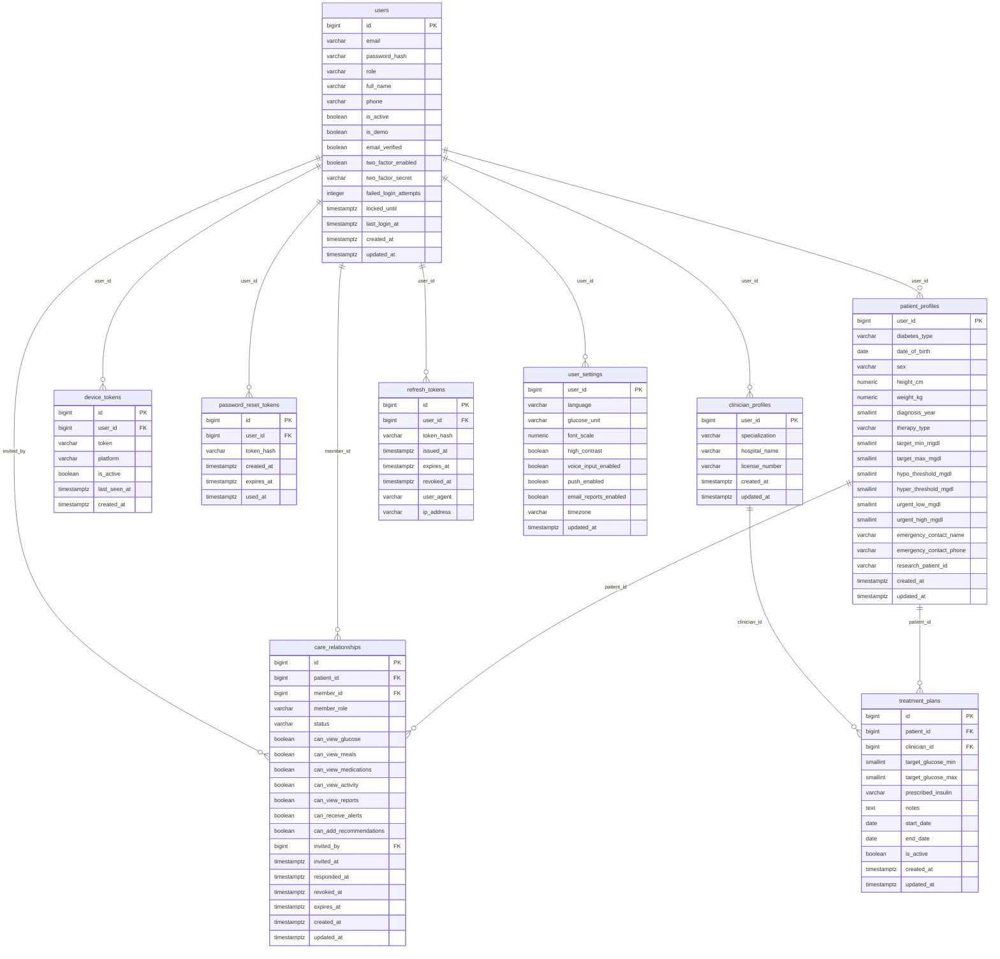
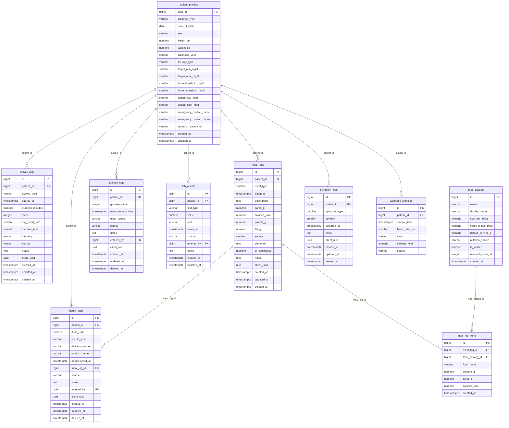
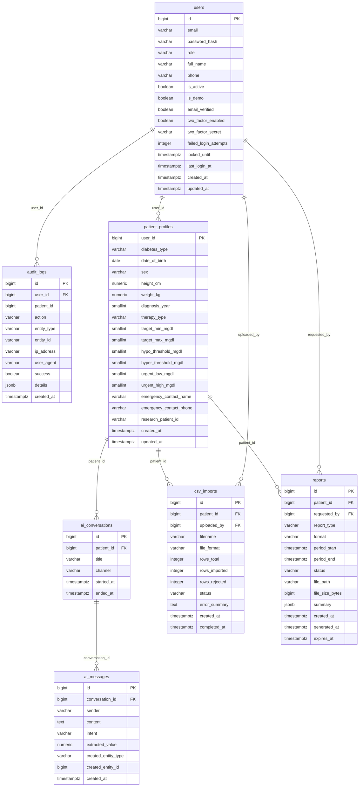
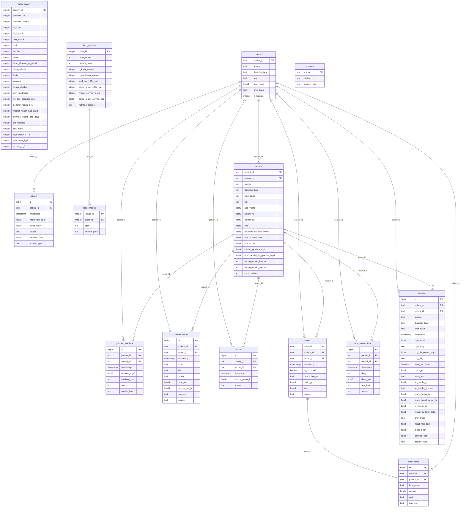

# DiaMate entity-relationship diagrams

Mermaid diagrams (GitHub, VS Code, Obsidian and many other tools render them). Generated from the foreign keys of the installed database.

## Accounts, roles and sharing

## Daily logs

## Medication, reminders, alerts

```mermaid
erDiagram
    alerts {
        bigint id PK
        bigint patient_id FK
        varchar alert_type
        varchar severity
        bigint glucose_log_id FK
        bigint reminder_event_id FK
        numeric value_mgdl
        varchar message
        timestamptz triggered_at
        varchar status
        bigint acknowledged_by FK
        timestamptz acknowledged_at
        timestamptz resolved_at
        timestamptz follow_up_due_at
        timestamptz follow_up_completed_at
        timestamptz created_at
    }
    clinician_profiles {
        bigint user_id PK
        varchar specialization
        varchar hospital_name
        varchar license_number
        timestamptz created_at
        timestamptz updated_at
    }
    medication_intakes {
        bigint id PK
        bigint patient_id FK
        bigint medication_id FK
        varchar medication_name
        varchar dose_text
        timestamptz taken_at
        varchar status
        bigint reminder_event_id FK
        text notes
        uuid client_uuid
        timestamptz created_at
        timestamptz updated_at
        timestamptz deleted_at
    }
    medications {
        bigint id PK
        bigint patient_id FK
        varchar name
        varchar medication_type
        varchar dosage
        numeric dose_amount
        varchar dose_unit
        varchar frequency_text
        text instructions
        bigint prescribed_by FK
        date start_date
        date end_date
        boolean is_active
        timestamptz created_at
        timestamptz updated_at
    }
    notifications {
        bigint id PK
        bigint recipient_id FK
        bigint alert_id FK
        bigint reminder_event_id FK
        varchar notification_type
        varchar title
        text body
        varchar channel
        varchar status
        varchar error_message
        timestamptz created_at
        timestamptz sent_at
        timestamptz read_at
    }
    patient_profiles {
        bigint user_id PK
        varchar diabetes_type
        date date_of_birth
        varchar sex
        numeric height_cm
        numeric weight_kg
        smallint diagnosis_year
        varchar therapy_type
        smallint target_min_mgdl
        smallint target_max_mgdl
        smallint hypo_threshold_mgdl
        smallint hyper_threshold_mgdl
        smallint urgent_low_mgdl
        smallint urgent_high_mgdl
        varchar emergency_contact_name
        varchar emergency_contact_phone
        varchar research_patient_id
        timestamptz created_at
        timestamptz updated_at
    }
    recommendations {
        bigint id PK
        bigint patient_id FK
        bigint clinician_id FK
        text message
        timestamptz created_at
        timestamptz read_at
    }
    reminder_events {
        bigint id PK
        bigint reminder_id FK
        bigint patient_id FK
        timestamptz scheduled_for
        varchar status
        timestamptz sent_at
        timestamptz acknowledged_at
        timestamptz snoozed_until
    }
    reminders {
        bigint id PK
        bigint patient_id FK
        bigint medication_id FK
        varchar reminder_type
        varchar medication_name
        varchar dosage
        varchar message
        time_without_time_zone scheduled_time
        varchar days_of_week
        varchar timezone
        boolean is_active
        integer missed_count
        timestamptz last_triggered_at
        timestamptz created_at
        timestamptz updated_at
    }
    users {
        bigint id PK
        varchar email
        varchar password_hash
        varchar role
        varchar full_name
        varchar phone
        boolean is_active
        boolean is_demo
        boolean email_verified
        boolean two_factor_enabled
        varchar two_factor_secret
        integer failed_login_attempts
        timestamptz locked_until
        timestamptz last_login_at
        timestamptz created_at
        timestamptz updated_at
    }
    users ||--o{ alerts : "acknowledged_by"
    patient_profiles ||--o{ alerts : "patient_id"
    reminder_events ||--o{ alerts : "reminder_event_id"
    users ||--o{ clinician_profiles : "user_id"
    medications ||--o{ medication_intakes : "medication_id"
    patient_profiles ||--o{ medication_intakes : "patient_id"
    reminder_events ||--o{ medication_intakes : "reminder_event_id"
    patient_profiles ||--o{ medications : "patient_id"
    clinician_profiles ||--o{ medications : "prescribed_by"
    alerts ||--o{ notifications : "alert_id"
    users ||--o{ notifications : "recipient_id"
    reminder_events ||--o{ notifications : "reminder_event_id"
    users ||--o{ patient_profiles : "user_id"
    clinician_profiles ||--o{ recommendations : "clinician_id"
    patient_profiles ||--o{ recommendations : "patient_id"
    patient_profiles ||--o{ reminder_events : "patient_id"
    reminders ||--o{ reminder_events : "reminder_id"
    medications ||--o{ reminders : "medication_id"
    patient_profiles ||--o{ reminders : "patient_id"
```

## Reports, imports, AI assistant, audit

## Research schema (open datasets)

