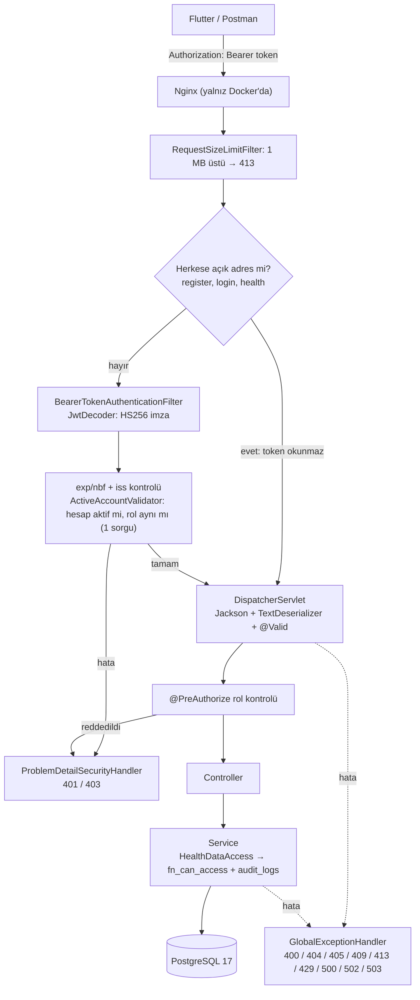
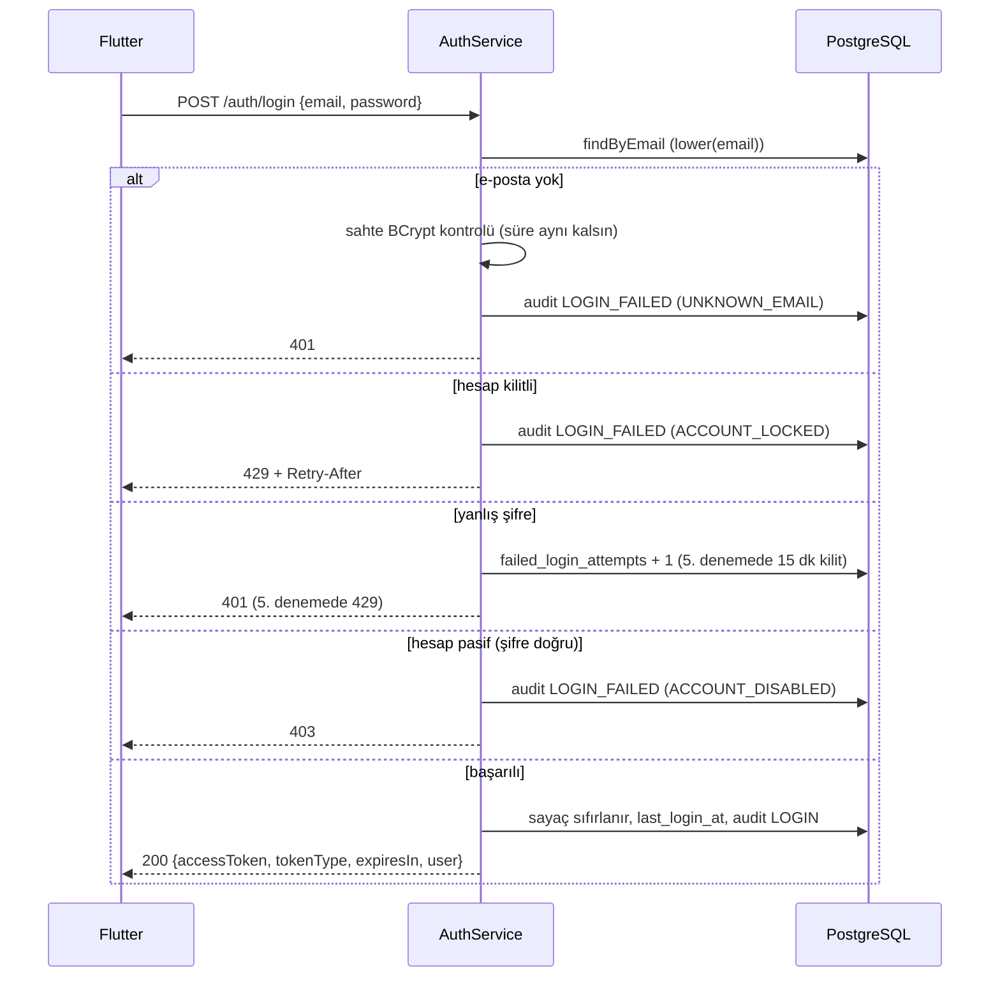

# Backend İncelemesi (2. hafta)

| | |
|---|---|
| Tarih | 12 Ekim 2026 (1. gün: inceleme; 2. gün: auth akışı, bkz. [bölüm 8](#8-2-gün-auth-akışının-doğrulanması); 3. gün: sağlık kayıtları ve uyarılar, bkz. [bölüm 9](#9-3-gün-sağlık-kayıtları-ve-uyarılar); 4. gün: yapay zekâ akışı, bkz. [bölüm 10](#10-4-gün-yapay-zekâ-sonuçlarının-kayda-dönüşmesi)); 13 Ekim: `main` ile birleştirme, bkz. [bölüm 11](#11-main-ile-birleştirme-13-ekim); 5. gün: güvenlik, bkz. [bölüm 12](#12-5-gün-güvenlik); 6. gün: kendi QA turu ve hata düzeltme, bkz. [bölüm 13](#13-6-gün-hata-düzeltme-kendi-qa-turu) |
| Hazırlayan | Melih (Backend & Security) |
| Görev | *Review backend architecture, auth/JWT and current CRUD endpoints* |
| İncelenen kod | `melih` dalı, commit `5079967` + bu günün düzeltmesi (rol adı `CLINICIAN`'a geri alındı) |
| Karşılaştırılan | Takım reposu `CMPE406---Graduation-Project`: `backend`, `frontend` (Flutter), `ai` (FastAPI) dalları, 11 Ekim'deki son `fetch` hali |

> **Takım reposu için not:** Bu rapor Melih'in çalışma reposunda yazıldı. Oradaki `DiaMate/` klasörü bu repodaki `backend/` klasörüdür; `DiaMate/Frontend` Flutter uygulamasıdır (bu repoda `frontend` dalı); `../Database` şema paketi bu repoda henüz yok (bkz. B-2).

Bu doküman her gün güncellenir. Bölüm 0–7 1. günün incelemesidir; sayılar ve bulguların durumu 6. günün sonuna göre güncellendi.

## 0. Özet

| Ölçü | Değer |
|---|---|
| Endpoint | **35**: health 2, auth 2, kullanıcı/rol 4 (`PATCH /admin/users/{id}/status` 5. günde), hasta özeti 1, sağlık kayıtları 4 × 5 = 20, uyarılar 4 (Nilsu'nun 3'ü + `GET /care-team/alerts` 5. günde), yapay zekâ 2 |
| Otomatik test | **242**, hepsi geçiyor (`mvn test`, veritabanı gerekmez). 1. günde 139, 2. günde 148, 3. günde 188, 4. günde 205, birleştirmede 210, 5. günde 234 |
| Postman | 12 klasörde **204** istek ve 348 assertion; yerel veritabanında hepsi geçiyor. 1. günde 7 klasör, 105 istek |
| Şema sürümü | Flyway V7 (`V1` = `Database/sql` paketi; V5 3. günde, V6 4. günde, V7 5. günde eklendi) |
| Takım reposu | `backend` dalı GP ile aynı kodu taşıyor (yalnız `README.md` farklı). `backend`, `frontend` ve `ai` dalları henüz `main`'e merge edilmedi |

**Öne çıkan bulgular** (ayrıntı: [bölüm 5](#5-bulgular)):

1. ✅ **Düzeltildi:** Commit'lenmemiş `Role.CLINICIAN → DOCTOR` değişikliği 2 testi kırıyor, veritabanı CHECK kuralına, Flutter'a ve `CareTeamController` yetki kuralına aykırıydı. Rol adı `CLINICIAN` olarak kaldı.
2. **Takım reposunda `docker compose up` backend'i açamaz:** Veritabanı boş başlar, `V1` şeması takım reposunda yok. Ayrıca yapay zekâ servisi compose'a eklenmemiş. *(4. gün: hazır compose parçası ve V1 seçenekleri bölüm 10.5'te; takım reposunda uygulanmadı.)*
3. ✅ **3. günde kapatıldı:** İnsülin, öğün ve aktivite kayıtlarının tek kayıt okuma, güncelleme ve silme işlemleri hiçbir testte ve Postman'de denenmiyordu. Glukoz tam kapsanmıştı.
4. **Flutter'da ekranı olan bazı özelliklerin backend'i yok:** Uyarı listesi, hatırlatıcılar, paylaşım/davet, hasta profili. Paylaşım akışı olmadığı için yeni bir hasta hiçbir doktor ya da bakıcıyla eşleşemiyor.
5. Auth tarafında **refresh token yok** (karar: sonraya bırakıldı) ve Flutter oturumu açılışta sunucuya doğrulatmıyor. Kalan bulgular düşük öncelikli.

---

## 1. Mimari

### 1.1 Katmanlar

| Katman | Paket | Görevi |
|---|---|---|
| Filtre | `security.RequestSizeLimitFilter` | 1 MB'tan büyük gövdeyi Spring Security'den önce reddeder (413) |
| Güvenlik | `security.*` | JWT doğrulama, rol → yetki, 401/403 problem+json |
| HTTP | `api.controller`, `api.dto` | Adresler, `@Valid` kuralları, `@PreAuthorize` rol kontrolü |
| İş mantığı | `service` | Veri erişim kuralı (`HealthDataAccess`), kayıt kuralları (`LogRules`), uyarılar, denetim kaydı |
| Veri | `repository`, `entity` | Spring Data JPA; erişim kuralı ve görünümler için düz SQL (`PatientAccessRepository`) |
| Dış servis | `ai` | FastAPI'ye giden `RestClient` (2 sn bağlantı, 10 sn okuma zaman aşımı) |
| Hata | `exception` | `GlobalExceptionHandler`: controller'a ulaşan her hata RFC 9457 biçiminde |

### 1.2 Bir isteğin yolu



Hata cevabı iki yerde üretilir:
- Controller'a ulaşmadan önceki hatalar (401/403) için `ProblemDetailSecurityHandler`.
- Diğer tüm hatalar için `GlobalExceptionHandler`.

İkisi de aynı JSON biçimini yazar. `@PreAuthorize`'ın fırlattığı `AccessDeniedException`, `GlobalExceptionHandler`'da yeniden fırlatılır. Böylece 403 genel `Exception` yakalayıcısına düşüp 500'e dönmez.

### 1.3 Temel tasarım kararları (değerlendirme)

| Karar | Değerlendirme |
|---|---|
| Rol kontrolü `@PreAuthorize`'da, veri erişimi veritabanındaki `fn_can_access`'te | ✅ Doğru ayrım. Kural tek yerde. Yalnız rol kontrolü olsaydı her doktor her hastayı okuyabilirdi |
| Erişim yoksa 403 değil **404** | ✅ Hasta kimliklerinin var olup olmadığı dışarıya sızmaz |
| Yazma şimdilik yalnız hastanın kendisinde (`HealthDataAccess.checkCanWrite`) | ✅ Kural tek yerde. Genişletme kararı ileride verilecek |
| Okuma servislerinde `@Transactional` yok | ✅ Bilinçli: denetim kaydı kendi transaction'ında yazılıyor. Yorumlarda açıklanmış |
| Soft delete + `clientUuid` ile tekrar gönderime dayanıklılık | ✅ Mobilde ağ kopmasına karşı doğru yaklaşım |
| Yapay zekâ sonucu kaydedilmez, hasta onaylar | ✅ Yanlış tanınan bir değerin sağlık verisine girmesini engeller |
| `ddl-auto: validate` + Flyway | ✅ Şemayı yalnız migration'lar değiştirir |

---

## 2. Kimlik doğrulama ve JWT

### 2.1 Kayıt (`POST /auth/register`)

1. `@Valid` alan kurallarını kontrol eder: ad/soyad yalnız harf, e-posta biçimi, şifre en az 8 karakter. Ayrıca `TextDeserializer` kontrol karakterlerini reddeder.
2. `AuthService.register` şu kuralları uygular:
   - `ADMIN` kendi kendine kayıt olamaz (400).
   - En az 16 yaş gerekir, en fazla 120 yıl önce doğmuş olunabilir (400).
   - `PasswordPolicy`: 72 bayt sınırı, yaygın şifreler ve e-postanın kendisi reddedilir.
3. E-posta küçük harfe çevrilir. Aynı e-posta varsa 409 döner. Paralel isteklerde benzersizlik ihlali de 409'a çevrilir.
4. Şifre BCrypt ile saklanır. Rol `PATIENT` ise aynı transaction içinde `patient_profiles` satırı da açılır (`diabetes_type = OTHER`).

### 2.2 Giriş (`POST /auth/login`)



### 2.3 Token

| Alan | Değer |
|---|---|
| Algoritma | HS256 (`JWT_SECRET`, base64, en az 32 bayt; kısaysa uygulama açılmaz) |
| `iss` | `diamate-backend` (başka bir değer reddedilir) |
| `sub` | Kullanıcı id'si |
| `role` | `PATIENT` / `CLINICIAN` / `CAREGIVER` / `ADMIN` → Spring'de `ROLE_<rol>` |
| `iat`, `exp` | Ömür `JWT_EXPIRATION` ile belirlenir (varsayılan 1 saat) |

Token'ın içeriği şifreli değildir (yalnızca base64). Bu yüzden içinde kişisel veri yoktur, bu doğru bir tercih.

### 2.4 Her istekte token doğrulama

1. İmza (HS256) kontrol edilir.
2. `exp` / `nbf` kontrol edilir. Spring'in varsayılan **60 saniyelik saat toleransı** geçerlidir.
3. `iss` kontrol edilir.
4. `ActiveAccountValidator` tek bir sorguyla (`findActiveUserRole`) hesabın hâlâ var ve aktif olduğunu, rolün token'daki rolle aynı olduğunu kontrol eder. Uymazsa **401** döner.

Herkese açık adreslerde (`register`, `login`, `health`) `Authorization` başlığı hiç okunmaz. Böylece süresi dolmuş bir token girişi engelleyemez.

### 2.5 Değerlendirme

**Güçlü yönler:**
- Kullanıcı sayımı (enumeration) korunuyor: bilinmeyen e-posta ve yanlış şifre aynı mesajı alıyor ve aynı sürede cevaplanıyor.
- Kaba kuvvet denemelerine karşı kilit var. Sayaç veritabanında atomik `+ 1` ile artıyor.
- Hesap pasife alınır ya da rolü değişirse eski token'lar hemen geçersiz oluyor.
- Giriş ve başkasının verisini okuma olayları denetim kaydına yazılıyor. Şifre ve token hiçbir yerde loglanmıyor.

**Açık konular** (bölüm 5'te sıralandı):
- Refresh token yok: 1 saat sonunda kullanıcı yeniden giriş yapmak zorunda. *2. gün kararı: sonraya bırakıldı.*
- Sunucu tarafında logout yok: çıkış yapılsa da token süresi dolana kadar geçerli kalır. *Refresh token ile birlikte sonraya bırakıldı.*
- ~~`JwtService` saati `Instant.now()` ile alıyor, diğer servisler gibi `Clock` kullanmıyor.~~ *2. günde düzeltildi.*
- `CLINICIAN` hesapları doğrulanmadan açılabiliyor.
- `ADMIN` hesabı yalnızca veritabanından oluşturulabiliyor. Bu bir karar ve doğru, ama dokümante edilmeli.

---

## 3. Endpoint envanteri

Tüm adresler `/api/v1` ile başlar (actuator hariç).

**Rol** sütunu `@PreAuthorize` kuralını, **Veri** sütunu servis katmanındaki kuralı gösterir.

**Postman** kısaltmaları:
- H = Health
- A = Auth
- S = Security checks
- R = RBAC (Day 3)
- L = Health logs (Day 4)
- V = Validation & security (Day 5)
- B = Bug fixes (Day 6)
- W = Auth flow (Week 2 Day 2)
- W3 = Health logs & alerts (Week 2 Day 3)
- W4 = AI workflow (Week 2 Day 4)

Bunlara ek olarak `ProtectedRoutesTest` (2. gün; 3. günde 30, 4. günde 31, birleştirmede 32, 5. günde 34 endpoint'e güncellendi; rol kuralları ayrıca `AuthorizationMatrixTest`'te) tablodaki tüm endpoint'leri token'sız çağırır ve yalnızca `register`, `login` ve `health`'in 401 dışında cevap verdiğini doğrular.

### 3.1 Kimlik, kullanıcı, hasta özeti, yapay zekâ

| Metot ve adres | Rol | Veri | Başarı | Hatalar | Testler | Postman |
|---|---|---|---|---|---|---|
| `GET /health` | herkese açık | — | 200 | 405 | `AuthControllerTest` | H, B |
| `GET /actuator/health` | herkese açık | — | 200 / 503 | — | — | H |
| `POST /auth/register` | herkese açık | — | 201 | 400, 405, 409, 413 | `AuthControllerTest`, `AuthServiceTest`, `PasswordPolicyTest` | A, V, B, W |
| `POST /auth/login` | herkese açık | — | 200 | 400, 401, 403, 429 | `AuthControllerTest`, `AuthServiceTest`, `AuditServiceTest`, `JwtServiceTest` | A, V, B, W |
| `GET /users/me` | giriş yapmış herkes | yalnız kendisi | 200 | 401, 403 | `RbacWebTest`, `UserServiceTest` | R, W |
| `GET /admin/users` | `ADMIN` | sağlık verisi yok | 200 | 401, 403 | `RbacWebTest`, `UserServiceTest` | R |
| `PATCH /admin/users/{userId}/status` *(5. gün)* | `ADMIN` | kendi hesabı hariç; denetim kaydı | 200 | 400, 401, 403, 404, 409 | `RbacWebTest`, `UserServiceTest` | W5 |
| `GET /care-team/patients` | `CLINICIAN`, `CAREGIVER` | yalnız ACTIVE ilişkiler | 200 | 401, 403 | `RbacWebTest`, `PatientServiceTest` | R |
| `GET /care-team/alerts` *(5. gün)* | `CLINICIAN`, `CAREGIVER` | uyarı paylaşan hastalar; sayfadaki hastalar denetime yazılır | 200, sayfalı | 400, 401, 403 | `RbacWebTest`, `AlertServiceTest` | W5 |
| `GET /patients/{id}/overview` | giriş yapmış herkes | `fn_can_access(…, 'glucose')` | 200 | 400, 401, 404 | `RbacWebTest`, `PatientServiceTest` | R, L, B |
| `GET /patients/{id}/alerts?status=&from=&to=` *(Nilsu)* | giriş yapmış herkes | `fn_can_access(…, 'alerts')` + denetim kaydı | 200, sayfalı | 400, 401, 404 | `AlertWebTest`, `AlertServiceTest` | W3 |
| `GET /patients/{id}/alerts/{alertId}` *(Nilsu)* | giriş yapmış herkes | aynı | 200 | 400, 401, 404 | `AlertWebTest`, `AlertServiceTest` | W3 |
| `PATCH /patients/{id}/alerts/{alertId}` *(Nilsu)* | giriş yapmış herkes | aynı; `ACKNOWLEDGED` / `RESOLVED` | 200 | 400, 401, 404, 409 | `AlertWebTest`, `AlertServiceTest` | W3 |
| `POST /ai/parse` | `PATIENT` | hiçbir şey kaydedilmez | 200 | 400, 401, 403, 502, 503 | `HealthLogWebTest`, `AiServiceTest`, `AiClientTest` | L, W4 |
| `POST /patients/{id}/ai-entries` *(4. gün)* | `PATIENT` | yalnız kendi id'si; hepsi ya da hiçbiri | 201 / 200 | 400, 401, 403, 404, 409, 413 | `AiEntryWebTest`, `AiEntryServiceTest` | W4 |

### 3.2 Sağlık kayıtları (4 tür × 5 işlem = 20 endpoint)

Adres: `/patients/{patientId}/{glucose|insulin|meal|activity}-logs[/{logId}]`

| İşlem | Rol | Veri | Başarı | Hatalar |
|---|---|---|---|---|
| `POST` | `PATIENT` | yalnız kendi id'si | 201 + `Location`; aynı `clientUuid` → 200 | 400, 401, 403, 404, 409, 413 |
| `GET` (liste) | giriş yapmış herkes | `fn_can_access(izin)` + denetim kaydı | 200, sayfalı (son 14 gün; `size` ≤ 200) | 400, 401, 404 |
| `GET /{logId}` | giriş yapmış herkes | aynı | 200 | 400, 401, 404 |
| `PUT /{logId}` | `PATIENT` | yalnız kendi id'si | 200 | 400, 401, 403, 404 |
| `DELETE /{logId}` | `PATIENT` | yalnız kendi id'si | 204 (soft delete) | 401, 403, 404 |

İzinler: glukoz → `glucose`, insülin → `medications`, öğün → `meals`, aktivite → `activity`.

### 3.3 Test kapsamı (sağlık kayıtları)

Her hücre üç bilgi taşır: **web testi / servis testi / Postman**. ✅ var, ❌ yok, ◐ yalnız erişim reddi deneniyor.

| İşlem | Glukoz | İnsülin | Öğün | Aktivite |
|---|---|---|---|---|
| `POST` | ✅ / ✅ / ✅ | ✅ / ✅ / ✅ | ✅ / ✅ / ✅ | ✅ / ✅ / ✅ |
| `GET` liste | ✅ / ✅ / ✅ | ✅ / ✅ / ✅ | ✅ / ✅ / ✅ | ✅ / ✅ / ✅ |
| `GET` tek | ✅ / ✅ / ✅ | ✅ / ✅ / ✅ | ✅ / ✅ / ✅ | ✅ / ✅ / ✅ |
| `PUT` | ✅ / ✅ / ✅ | ✅ / ✅ / ✅ | ✅ / ✅ / ✅ | ✅ / ✅ / ✅ |
| `DELETE` | ✅ / ✅ / ✅ | ✅ / ✅ / ✅ | ✅ / ✅ / ✅ | ✅ / ✅ / ✅ |

*3. gün sonu.* Yeni testler: `LogEndpointsWebTest` (web), `InsulinLogServiceTest` ve `MealAndActivityLogServiceTest` (servis), Postman W3 klasörü. 1. gün sonundaki durum: insülin, öğün ve aktivitede `GET` tek, `PUT` ve `DELETE` için ❌ (ne test ne Postman), listede yalnızca izin reddi deneniyordu.

1. günün değerlendirmesi: Dört tür aynı kalıpla yazılmış ve glukoz tam test edilmiş. Bu yüzden risk düşük, ama türe özel kısımlar güncelleme ve silmede hiç denenmedi:
- insülin güncellemesinde `mealLogId` kontrolü,
- güncellenen aktivitenin `MANUAL` kalması,
- öğün silinince ona bağlı insülin dozu. Bu durum kod okunarak incelendi ve bir hata bulundu: [B-12](#5-bulgular).

Bu boşluk 3. günde kapatıldı (bkz. [B-3](#5-bulgular) ve [bölüm 9](#9-3-gün-sağlık-kayıtları-ve-uyarılar)).

---

## 4. Entegrasyon sözleşmeleri

### 4.1 Flutter (`frontend` dalı)

| Konu | Durum |
|---|---|
| Adres | `ApiConfig`: `API_BASE_URL` (derleme değişkeni) ya da `localhost:8080` / Android emülatörde `10.0.2.2:8080`, önek `/api/v1` ✅ |
| Rol | Uygulamadaki `doctor` ↔ API'de `CLINICIAN`. Bu yüzden `DOCTOR`'a geçilmedi ✅ |
| Enum değerleri | `gender`, `mealContext`, `mealType`, `insulinType`, `deliveryMethod`, `intensity`: backend'le birebir aynı ✅ |
| Alan adları | `UserResponse`, `GlucoseLogResponse` vb. alan adlarıyla okunuyor (sıra önemsiz) ✅ |
| Hatalar | `detail` ve `errors` alanları okunuyor; 401'de token silinip giriş ekranına dönülüyor ✅ |
| `clientUuid`, saatler | Her kayıtta UUID gönderiliyor; saatler UTC ISO-8601 ✅ |
| Bağlı ekranlar | Kayıt, giriş, dashboard, glukoz/insülin/öğün/aktivite girişi, glukoz grafiği; *13 Ekim:* doktor ve bakıcı uyarı kartları + uyarılar ekranı (`PATCH` ile onay/çözme). Flutter projesi artık bu repoda: `DiaMate/Frontend/` |
| Henüz bağlı değil, backend hazır | Doktor ve bakıcı dashboard'unda hasta özeti ve kayıt okuma (`/care-team/patients`, `/overview`), Dia asistanı (`/ai/parse` + `ai-entries`, 4. gün) |
| Henüz bağlı değil, backend yok | Hatırlatıcılar, aile/bakıcı ekleme (paylaşım), çocuk profili, PDF rapor, CSV içe aktarma, çevrimdışı mod (bkz. [B-4](#5-bulgular)) |

### 4.2 FastAPI (`ai` dalı)

| Konu | Durum |
|---|---|
| Backend → AI | `POST {AI_SERVICE_BASE_URL}/api/v1/nlp/parse-multiple`, gövde `{text}` (en fazla 500 karakter, iki tarafta aynı) ✅. *4. gün: gerçek FastAPI ile uçtan uca denendi (bölüm 10.3)* |
| AI sonucu → kayıt | *4. gün:* `POST /patients/{id}/ai-entries`. Dönüşüm kuralları (`125.0` → 125, saat → dakika, km → not) backend'de ✅ |
| Cevap | `{status, results[{intent, status, value, unit, activity, message}], message}` → backend'de `{status, resultCount, results, message}` ✅ |
| Adres ayarı | Backend tarafında zaten ortam değişkeninden okunuyor (`AI_SERVICE_BASE_URL`, varsayılan `http://localhost:8000`) ✅ |
| `integration/aggregate-history`, `integration/patient-summary` | FastAPI, backend'in DTO alan adlarını (`patientId`, `measurementTime`, `glucoseValue`, `eatenAt`, `carbsG`…) bekliyor; adlar uyumlu ✅. Backend bu endpoint'leri **henüz çağırmıyor**. 4. günde kapsam dışı bırakıldı; sonraki işler arasında |

---

## 5. Bulgular

Öncelik: **Y** yüksek, **O** orta, **D** düşük. **Gün** sütunu, bulgunun 2. haftanın hangi gününde ele alınacağını gösterir.

| # | Ö | Bulgu | Öneri | Gün |
|---|---|---|---|---|
| B-1 | Y | Commit'lenmemiş `Role.CLINICIAN → DOCTOR` değişikliği: 2 test kırık. Ayrıca veritabanındaki `users.role` CHECK kuralı yüzünden doktor kaydı 500, mevcut doktor hesaplarının girişi 500 olurdu; `CareTeamController` 403 verir, Flutter doktor kaydını reddederdi | ✅ **Düzeltildi:** rol adı `CLINICIAN` olarak kaldı, 139/139 test geçiyor | 1 |
| B-2 | Y | Takım reposu kökündeki `docker-compose.yml` boş bir `postgres:17` başlatıyor. `V1` şeması (`Database/sql`) takım reposunda yok, bu yüzden Flyway V2 `users` tablosunu bulamaz ve backend açılmaz. Ayrıca compose'da `ai-service` servisi ve `AI_SERVICE_BASE_URL` yok, `/ai/parse` 503 döner. *Kod ve konfigürasyon okunarak tespit edildi, çalıştırılarak doğrulanmadı* | `Database/sql`'i takım reposuna ekle ya da V1'i Flyway migration'ı yap; compose'a `ai-service` ekleyip `AI_SERVICE_BASE_URL=http://ai-service:8000` ver. 1. haftanın 7. günü (merge + entegrasyon testi) ile birlikte. **4. gün:** `ai-service` için hazır compose parçası ve V1 seçenekleri yazıldı ([bölüm 10.5](#105-takım-compose-dosyası-için-öneri-b-2)). Takım reposunda uygulanmadı; Ayşen ve 1. haftanın 7. günündeki merge ile birlikte | 4 → takım |
| B-3 | Y | İnsülin, öğün ve aktivite için `GET` tek, `PUT` ve `DELETE` hiç test edilmiyor; liste yalnız izin reddi için deneniyor (bkz. 3.3) | ✅ **Kapatıldı:** `LogEndpointsWebTest` + servis testleri + Postman W3; gerçek veritabanında dört türün tüm yaşam döngüsü denendi | 3 |
| B-4 | O | Flutter'da ekranı olan ama backend'i olmayan özellikler: uyarı listesi ve onaylama (overview yalnızca sayı veriyor), hatırlatıcılar, paylaşım/davet, hasta profili (diyabet tipi, hedef aralık; kayıtta `OTHER`), çocuk profili, PDF rapor, CSV içe aktarma. Tabloları şemada var. **Paylaşım akışı olmadığı için yeni hastalar hiçbir doktor ya da bakıcıyla eşleşemiyor**; doktor ve bakıcı ekranları yalnız demo verisiyle çalışır | Takımla önceliklendir. ✅ **3. gün:** Uyarı listesi ve onaylama eklendi (hasta ve `alerts` izinli bakım ekibi). **Açık:** Hatırlatıcılar, paylaşım/davet, hasta profili, çocuk profili, PDF, CSV; paylaşım ve hasta profili sonraki haftaya | 3 → sonra |
| B-5 | O | Flutter `restoreSession` token'ı yalnız yerelde (süreye bakarak) kontrol ediyor. Pasife alınan ya da rolü değişen hesap, ilk API çağrısına kadar uygulamada kalır | Uygulama açılışında `GET /users/me` çağrılsın (Nilsu ile). **2. gün:** Backend tarafı hazır ve doğrulandı; `/users/me` `AppUser`'ın tüm alanlarını döndürüyor. Kalan iş Flutter tarafında | 2 → Flutter |
| B-6 | O | Refresh token yok; 1 saat sonra kullanıcı yeniden giriş yapmalı. Sunucu tarafında logout yok. `refresh_tokens` tablosu şemada hazır | **Karar (12 Ekim): sonraya bırakıldı.** Yapıldığında: dönen ve tek kullanımlık refresh token + `POST /auth/refresh` + `POST /auth/logout`. Şimdilik README'de dokümante edildi | sonra |
| B-7 | D | `JwtService` `Instant.now()` kullanıyor; diğer servisler `Clock` kullanıyor. Token süresi testte sabitlenemiyor | ✅ **Düzeltildi:** `Clock` enjekte edildi; `JwtServiceTest` `iat` ve `exp` değerlerini saniyesi saniyesine kontrol ediyor | 2 |
| B-8 | D | `activity_logs.source` CHECK kuralı `AI_ASSISTANT` değerini kabul etmiyor; yapay zekâdan gelen aktivite `MANUAL` görünüyor (README'de yazıyor) | Migration ile CHECK kuralına `AI_ASSISTANT` ekle, `ActivityLogRequest`'e `source` ekle. ✅ **Düzeltildi:** V6 + `ActivitySource.AI_ASSISTANT` + `ActivityLogRequest.source` | 4 |
| B-9 | D | Herkes doğrulama olmadan `CLINICIAN` olarak kayıt olabiliyor. Bugün paylaşım akışı olmadığı için risksiz; akış gelince risk olur | Paylaşım akışından önce: doktor hesabı `is_active = false` başlasın, ADMIN onaylasın (ya da davet koduyla kayıt). ✅ **5. günde yapıldı:** yeni doktor pasif başlar, `PATCH /admin/users/{id}/status` ile onaylanır; onaysız girişte "waiting for approval" mesajı | 5 |
| B-10 | D | Takım Docker kurulumu: imaj `root` kullanıcısıyla çalışıyor; Postgres 5432 dışarı açık ve şifresi compose dosyasında düz metin; Nginx'te `/auth` için IP bazlı hız sınırı (`limit_req`) yok | Dockerfile'a `USER`; şifreyi `.env`'e taşı; 5432'yi kapat; `limit_req_zone` ekle ✅ **5. gün:** GP'ye sertleştirilmiş `DiaMate/Dockerfile` + `.dockerignore` (root olmayan kullanıcı, salt okunur jar, `.env` imajda yok); Nginx `limit_req` ve Postgres portu için takım reposuna hazır öneri (bölüm 12.6) | 5 → takım |
| B-11 | D | README'de `/ai/parse` cevabının üst düzey `message` alanı yazmıyordu | ✅ **Düzeltildi** (`DiaMate/README.md`) | 1 |
| B-12 | D | Öğün silinince ona bağlı insülin dozunun `mealLogId`'si silinmiş öğünü göstermeye devam ediyor. Veritabanındaki `ON DELETE SET NULL` yalnızca gerçek silmede çalışır, soft delete'te çalışmaz. Uygulama o öğünü açmaya çalışırsa 404 alır | ✅ **Düzeltildi:** `MealLogService.delete` aynı transaction'da `InsulinLogRepository.unlinkMeal` ile bağlı dozların `meal_log_id`'sini `NULL` yapıyor. Hatanın ikinci sonucu da giderildi: eski bağla güncelleme 400 alıyordu. Birim testi ve uçtan uca test eklendi | 3 |
| B-13 | O | *(2. gün)* Kendi kaydolan `CLINICIAN` için `clinician_profiles` satırı açılmıyor; `PATIENT` için `patient_profiles` açılıyor. `treatment_plans`, `medications.prescribed_by` ve `recommendations` bu tabloya bağlı, yani doktorla ilgili ileriki özellikler yeni doktorlarla çalışmaz. `Database/sql/11_verify.sql` kontrolü de "profili olmayan doktor" hatası verir. Uçtan uca testte doğrulandı | Kayıtta `CLINICIAN` için de profil satırı açılsın (`specialization` varsayılanı `General`). V5 migration eksik satırları tamamlasın (V4'ün doktor karşılığı). Migration ortak Neon'a da uygulanacağı için önce yerelde denenmeli. ✅ **Düzeltildi:** `ClinicianProfile` + kayıtta profil satırı; V5 yerel veritabanında uygulandı (profili olmayan doktor 2 → 0). Neon'a, biri yeni backend'i Neon'a bağlı açtığında uygulanır | 3 |
| B-14 | D | *(2. gün)* README `/actuator/health` için "yalnızca `{"status":"UP"}`" diyordu; cevapta `"groups":["liveness","readiness"]` da var. Bileşen ayrıntısı yok, yani iç bilgi sızmıyor | ✅ **Düzeltildi** (README) | 2 |
| B-15 | Y | *(5. gün, S-1)* `ai-entries`'te `value` için üst sınır yoktu. `1e999999999` gibi 11 karakterlik bir sayı, km/tekrar dönüşümünde milyar basamaklı bir metne çevrilip sunucunun belleğini tüketebilirdi (`1e100000` ile 100 001 karakter üretildiği doğrulandı) | ✅ **Düzeltildi:** `@DecimalMax(100000)` + `@Digits(6,3)` dönüşümden önce; km ≤ 1000, mil ≤ 1000, metre ≤ 100000, tekrar ≤ 10000; hata `entries[i].value` | 5 |
| B-16 | O | *(5. gün, S-2)* `page=2147483647` gibi bir sayfa, veritabanı offset'i int'e sığmadığı için **500** veriyordu (tüm sayfalı listeler) | ✅ **Düzeltildi:** `page × size` 2³¹'i geçemez, **400** `errors.page` | 5 |
| B-17 | O | *(5. gün)* Uyarı durumu "oku, Java'da değiştir, kaydet" ile değişiyordu (Nilsu'nun API'si): iki kişi aynı anda onaylarsa son yazan kazanıyor, backend'in `DISMISSED` yaptığı uyarı `ACKNOWLEDGED` olarak geri açılabiliyordu | ✅ **Düzeltildi:** tek koşullu `UPDATE` (`acknowledgeIfOpen`, `resolveIfNotClosed`); gerçek veritabanında 5 tur paralel istekle doğrulandı | 5 |
| B-18 | D | *(5. gün)* Uyarıyı kimin çözdüğü saklanmıyordu; değişiklikler denetim kaydına yazılmıyordu | ✅ **Düzeltildi:** V7 `alerts.resolved_by` + `resolvedBy`; `ALERT_STATUS_CHANGED` denetim kaydı (`entity_id` artık yazılıyor) | 5 |
| B-19 | D | *(5. gün)* Doktor/bakıcı ekranı hasta başına ayrı uyarı isteği atıyor, her biri denetim kaydına satır yazıyordu | ✅ **Backend:** `GET /care-team/alerts` (tek istek; denetim yalnız sayfadaki hastalar için). **Kalan:** Flutter'ın buna geçmesi (Nilsu) | 5 → Flutter |
| B-20 | D | *(5. gün)* Yeni Dockerfile'ın ilk halinde `app.jar` uygulama kullanıcısına aitti, yani süreç kendi jar'ının üzerine yazabiliyordu | ✅ **Düzeltildi:** jar root'a ait ve salt okunur; container içinde yazma denemesi "Permission denied" | 5 |
| B-21 | O | *(6. gün, kendi QA turu)* Veritabanının saklayamadığı zamanlar **500** veriyordu: `-1000000000-01-01T00:00:00Z` geçerli bir `Instant`, ama PostgreSQL "timestamp out of range" diyor. 4 kayıt türünün zamanı, `ai-entries`'in `at`'i, listelerin ve uyarıların `from`/`to`'su: tarama 18 tane 500 buldu | ✅ **Düzeltildi:** kayıt zamanı 1900'den önce olamaz (400, aynı alan); liste `from`/`to` 1900–9999 arasında olmalı (400 `errors.from` / `errors.to`); `ai-entries`'te `entries[i].at` | 6 |
| B-22 | D | *(6. gün)* Spring Security'nin güvenlik duvarının reddettiği adresler (`/patients/1;DROP/...`, `/patients/../...`) Spring Boot'un varsayılan `{"timestamp","status","error","path"}` gövdesini dönüyordu; diğer bütün hatalar `problem+json`. Tarama 64 tane buldu | ✅ **Düzeltildi:** `ProblemErrorController` `/error`'u `problem+json` ile cevaplıyor. **Kabul edildi:** `%00` ve `%2F` içeren adresleri Tomcat, Spring'e gelmeden kısa bir HTML sayfasıyla reddediyor (400; sürüm ya da iç bilgi yok, gerçek istemci göndermez) | 6 |
| B-23 | O | *(6. gün)* Aynı `clientUuid` ile **aynı anda** gelen iki istek (zayıf ağda uygulamanın yeniden denemesi, çift dokunma): ikisi de "kayıt yok" görüp ekliyordu, ikincisi benzersiz index'e çarpıp **409** alıyordu. Kayıt tek, ama uygulama "bu kayıt zaten var" hatası gösteriyordu. 40 turun 40'ında | ✅ **Düzeltildi:** `clientUuid` aranmadan önce PostgreSQL advisory lock (`pg_advisory_xact_lock`) alınıyor; ikinci istek ilkinin bitmesini bekleyip onun kaydını **200** ile dönüyor. 4 kayıt türü + `ai-entries`, 50/50 tur. Silinmiş kaydın `clientUuid`'si hâlâ 409, artık sebebiyle | 6 |
| B-24 | D | *(6. gün, kod incelemesi)* İki kişi aynı uyarıyı aynı anda farklı duruma geçirirse (biri onaylarken öteki çözerse) denetim kaydındaki `from`, isteği atanın gördüğü durumdur, gerçek önceki durum değil (ör. `OPEN → RESOLVED` yazar, oysa arada `ACKNOWLEDGED` olmuştu). Uyarının kendisi doğru (B-17) | **Kabul edildi:** iki satırın sırası ve zamanı denetim kaydında zaten var; düzeltmek için `UPDATE … RETURNING` ile eski durumu okumak gerekir, getirisi az | – |

---

## 6. 2. hafta: Melih'in günleri ve iş listesi

| Gün | Plandaki görev | Bu incelemeden çıkan somut işler |
|---|---|---|
| 1 | Review backend architecture, auth/JWT and current CRUD endpoints | ✅ Bu rapor; B-1 ve B-11 düzeltildi |
| 2 | Complete/verify authentication flow | ✅ B-7, B-14 düzeltildi; B-6 ertelendi; B-5 Flutter'a devredildi; B-13 bulundu. Ayrıntı: [bölüm 8](#8-2-gün-auth-akışının-doğrulanması) |
| 3 | Implement/complete data-entry endpoints | ✅ B-3, B-12, B-13 kapatıldı; uyarı listesi ve onaylama eklendi (B-4'ün bir kısmı). Ayrıntı: [bölüm 9](#9-3-gün-sağlık-kayıtları-ve-uyarılar) |
| 4 | Connect AI results with backend data workflow | ✅ `ai-entries` endpoint'i, B-8 (V6), gerçek FastAPI ile uçtan uca doğrulama; B-2 için compose önerisi. Ayrıntı: [bölüm 10](#10-4-gün-yapay-zekâ-sonuçlarının-kayda-dönüşmesi) |
| 5 | Strengthen security | ✅ B-9, B-10, B-15–B-20; yetki matrisi; gerçek süre dolumu ölçüldü; Ayşenur için güvenlik test listesi. Ayrıntı: [bölüm 12](#12-5-gün-güvenlik) |
| 6 | Fix QA bugs | ✅ QA raporu henüz yoktu; kendi QA turu: B-21, B-22, B-23 düzeltildi, B-24 kabul; kod incelemesi, Flutter sözleşmesi, tam regresyon. Ayrıntı: [bölüm 13](#13-6-gün-hata-düzeltme-kendi-qa-turu). Ayşenur'un listesi gelince aynı yöntemle |
| 7 | Final regression + endpoint/security documentation | Bu raporun endpoint envanterini güncelle; README; takım reposuna aktarım |

Ayrıca açık: **1. haftanın 7. günü** (takım reposunda dalların `main`'e merge'ü ve entegrasyon testi) hâlâ tamamlanmadı. B-2 bu işe bağlı.

## 7. Takım için notlar

- **Ayşenur (QA):** Master checklist için bölüm 3'teki tablolar kullanılabilir. Demo hesaplar: `../../Database/docs/DEMO_ACCOUNTS.md`. Postman koleksiyonu baştan sona çalıştırılabilir (*Run collection*). W3 klasörü insülin, öğün ve aktivitenin tam yaşam döngüsünü ve uyarıları dener; RBAC klasöründeki token'ları kullandığı için koleksiyonu baştan çalıştırın. Testler için yerel Docker veritabanı önerilir, ortak Neon verisi bozulmasın. **5. gün:** Negatif ve güvenlik testleri için bölüm 12.2 (yetki matrisi) ve 12.8 (test listesi) ile Postman'deki "Security (Week 2 Day 5)" klasörü kullanılabilir. **6. gün:** Bulunan 3 hata ve testleri bölüm 13.2'de; Postman'de "Bug fixes (Week 2 Day 6)" klasörü. Hata raporu gelirse her hata için *istek, beklenen, gelen* yeterli.
- **Nilsu (Flutter):** Doktor ve bakıcı dashboard'ları için gereken endpoint'ler hazır (bölüm 4.1). Hata gövdesinde her zaman `detail` var; 413, 429, 502 ve 503 için ayrı mesaj gerekmez. Açılışta `GET /users/me` önerisi: B-5. Backend tarafı 2. günde doğrulandı (bölüm 8.2). Uyarılar: Nilsu'nun API'si (`GET …/alerts`, `GET …/alerts/{id}`, `PATCH …/alerts/{id}`) birleştirmede korundu, Flutter ekranı onu kullanıyor (bölüm 11). Dia ekranı: önce `/ai/parse`, hasta onaylayınca `POST /patients/{id}/ai-entries`. Dönüşümü uygulama yapmaz; `MISSING_VALUE` kayıtlarında ve birimi `unspecified` olan aktivitelerde hastaya değeri ya da birimi sormak gerekir (bölüm 10). **5. gün:** (1) Yeni kaydolan doktor onaylanana kadar girişte 403 + "waiting for approval" alıyor; kayıttan sonra bunu göstermek iyi olur. (2) Uyarı ekranı hasta başına istek yerine `GET /care-team/alerts`'i kullanabilir (`?status=OPEN&size=1` → sayaç). (3) Uyarı cevabında yeni `resolvedBy` alanı var. **6. gün** (ayrıntı: bölüm 13.4): (4) Kayıt ekranı doktor için de hemen giriş yapıyor; giriş 403 aldığı için kullanıcı formda kalıyor ve tekrar basınca 409 alıyor. Doktor kaydından sonra giriş denemeden "onay bekleniyor" deyip giriş ekranına dönmek yeterli. (5) Dia ekranı hâlâ backend'e bağlı değil (sabit cevap); `/ai/parse` + `ai-entries` hazır. (6) Aynı `clientUuid` ile tekrar denemek artık her durumda güvenli: aynı kayıt 200 ile döner (B-23).
- **Ayşen (AI):** Backend'in yapay zekâ adresi zaten ortam değişkeninden okunuyor. FastAPI tarafındaki sabit adres kaldırılınca compose'da iki tarafın da `ai-service` adını kullanması yeterli (B-2). Hazır compose parçası: bölüm 10.5. `ai` dalının (`dbee6ec`) `parse-multiple` cevabı backend'le uyumlu çalıştı (bölüm 10.3).

---

## 8. 2. gün: auth akışının doğrulanması

Görev: *Complete/verify authentication flow: register, login, JWT validation and protected routes.*

Mevcut akış eksiksiz çalışıyordu, yeni endpoint gerekmedi. 2. günün işi akışı test ve gerçek veritabanı üzerinde kanıtlamak oldu. Bunun dışında küçük bir düzeltme (B-7) ve bir doküman düzeltmesi (B-14) yapıldı.

### 8.1 Kodda yapılanlar

| Dosya | Değişiklik |
|---|---|
| `security/JwtService.java` | Saat `Instant.now()` yerine `Clock`'tan alınıyor (B-7) |
| `security/JwtServiceTest.java` *(yeni, 3 test)* | Token içeriği: `alg` = HS256, `iss`, `sub` = kullanıcı id'si, `role`, `iat`, `exp` = `iat` + 1 saat, `expiresIn` = 3600. Yalnız bu beş claim var, ad ve e-posta yok. Her rol veritabanındaki adıyla yazılıyor |
| `api/controller/RbacWebTest.java` *(+5 test)* | Şu tokenlar 401 alıyor: başka anahtarla imzalanmış, başka `iss`, imzasız (`alg: none`, ADMIN rolüyle), `role` alanı olmayan. URL'de (`?access_token=`) ve `Basic` başlığıyla gelen token da 401 alıyor. İmzası ya da `iss` değeri hatalı token için veritabanına hiç sorgu gitmediği de doğrulanıyor |
| `api/controller/ProtectedRoutesTest.java` *(yeni)* | Spring'in endpoint listesindeki 28 controller endpoint'inin her biri token'sız çağrılıyor. Yalnızca `POST /auth/register`, `POST /auth/login` ve `GET /health` 401 dışında cevap verebilir, hiçbir servis çağrılmamış olmalı. İleride token'sız erişilebilen bir endpoint eklenirse test kırılır |
| `postman/…collection.json` | Yeni "Auth flow (Week 2 Day 2)" klasörü: 9 istek, 18 assertion |

`mvn test`: **148 test, 0 hata.**

### 8.2 Uçtan uca doğrulama (gerçek veritabanı)

**Ortam:** Backend `localhost:8080`, yerel Docker'daki PostgreSQL 17'ye (`localhost:5434`, Flyway V4, demo verisi) bağlıydı. Ortak Neon veritabanı kullanılmadı; `.env` değiştirilmedi, yerel ayarlar yalnızca çalıştırma sırasında verildi.

İstek gövdeleri Flutter'ın `frontend` dalındaki `lib/services/auth_service.dart` ve `lib/data/glucose_store.dart` dosyalarından **birebir** alındı. Yani uygulamanın göndereceği istekler aynen denendi.

| Grup | Ne denendi | Sonuç |
|---|---|---|
| Kayıt | Hasta, bakıcı ve doktor (`CLINICIAN`) kaydı 201 dönüyor; cevapta tam olarak `AppUser` alanları var, şifre yok. `"role": "DOCTOR"` → 400 + `errors.role` (problem+json). Aynı e-posta büyük harfle → 409 | 9/9 |
| Giriş | Üç rol de 200 alıyor; `tokenType` Bearer, `expiresIn` 3600, `user.role` doğru. Baş/sonda boşluklu ve büyük harfli e-postayla giriş 200. Uygulama eski token gönderse de giriş 200. Yanlış şifre ve bilinmeyen e-posta aynı 401 mesajını alıyor | 7/7 |
| Oturumu geri yükleme | Üç rolde de `GET /users/me` 200 dönüyor ve `AppUser`'ın tüm alanlarını veriyor (B-5'in backend tarafı) | 3/3 |
| Token | Token yok, bozuk token, URL'de token, `Basic` başlığı ve içeriği değiştirilmiş token: hepsi 401 | 5/5 |
| Rol ve veri erişimi | Yeni hasta kendi glukozunu kaydedebiliyor (201). Doktor yazamıyor (403). İlişkisi olmayan doktor okuyamıyor (404). Yeni doktorun hasta listesi `[]`. Bakıcı `/admin/users`'a erişemiyor (403) | 5/5 |
| Hesap değişikliği | Veritabanında pasife alınan hesabın eldeki token'ı hemen 401 alıyor. Doğru şifreyle giriş 403. Hesap yeniden aktif edilince aynı token yine 200 | 3/3 |
| Veritabanı | Hastaya `patient_profiles` satırı açılıyor, şifre BCrypt ile saklanıyor, e-posta küçük harfle kaydediliyor, girişler `audit_logs`'a yazılıyor | 4/4 |
| **Toplam** | | **36/36** |

Bu test yeni bir bulgu çıkardı: kendi kaydolan doktorun `clinician_profiles` satırı yok (**B-13**, 3. güne).

### 8.3 Postman koleksiyonunun tamamı (newman)

```bash
npx -y newman@6.2.1 run postman/DiaMate.postman_collection.json
```

Yerel backend'e karşı **114 istek, 195 assertion, 0 hata.** Bu çalıştırma 1.–6. günün tüm klasörlerini ve yeni "Auth flow (Week 2 Day 2)" klasörünü kapsıyor.

FastAPI kapalı olduğu için `/ai/parse` 503 döndü. Koleksiyon bunu doğru sonuç olarak kabul ediyor.

### 8.4 Sonuç ve kalanlar

Register, login, JWT doğrulama ve korumalı adresler üç seviyede doğrulandı: birim testleri, web katmanı testleri ve gerçek veritabanı. 2. gün için kalan backend işi yok. Açık konular:

- **B-5 (Flutter):** Uygulama açılışında `GET /users/me` çağrılmalı; 401 gelirse giriş ekranına dönülmeli. Backend tarafı hazır.
- **B-13 (3. gün):** Doktor kaydında `clinician_profiles` satırı + V5 migration.
- **B-6 (sonra):** Refresh token ve sunucu tarafında logout.
- **Süre dolumu:** Gerçek süre dolumu (1 saat + Spring'in 60 saniyelik toleransı) uçtan uca beklenmedi; `RbacWebTest.expiredTokenGets401` ile web katmanında test ediliyor. İstenirse 5. günde backend kısa bir `JWT_EXPIRATION` (ör. `1m`) ile açılıp uçtan uca da denenebilir.

---

## 9. 3. gün: sağlık kayıtları ve uyarılar

Görev: *Implement/complete diabetes data-entry endpoints for glucose, insulin, meal and activity records.*

> **Not (13 Ekim):** Bu bölümdeki uyarı API'si (`POST …/alerts/{alertId}/acknowledge`, `AlertService.acknowledgeIfOpen`, uyarı testleri) `main` ile birleştirmede Nilsu'nun aynı anda yazdığı API'yle değiştirildi. Aşağıdaki uyarı satırları 3. günün halini anlatır; güncel durum için bkz. [bölüm 11](#11-main-ile-birleştirme-13-ekim). Öğün–insülin bağı (B-12) ve doktor profili (B-13) aynen duruyor.

Flutter'ın dört giriş formunun gönderdiği alanlar backend'le birebir uyumluydu; yeni alan gerekmedi. 3. günün işi şunlardı: test boşluğunu kapatmak (B-3), iki veri tutarlılığı hatası (B-12, B-13) ve uyarıların listelenip onaylanması (B-4'ün bir kısmı).

### 9.1 Kodda yapılanlar

| Dosya | Değişiklik |
|---|---|
| `service/MealLogService.java`, `repository/InsulinLogRepository.java` | Öğün silinince bağlı insülin dozlarının `meal_log_id`'si aynı transaction'da `NULL` yapılıyor (`unlinkMeal`, düz SQL; silinmiş dozları da kapsar) (B-12) |
| `entity/ClinicianProfile.java`, `repository/ClinicianProfileRepository.java` *(yeni)*, `service/AuthService.java` | `CLINICIAN` kaydında `clinician_profiles` satırı açılıyor; yalnız `user_id` eşlendi, diğer sütunlar veritabanı varsayılanlarıyla dolar (B-13) |
| `db/migration/V5__create_missing_clinician_profiles.sql` *(yeni)* | Profili olmayan doktorlara satır ekler; yalnızca eksikleri ekler, tekrar çalışması zararsız (B-13) |
| `api/controller/AlertController.java`, `service/AlertService.java`, `api/dto/response/AlertResponse.java` *(yeni)* | `GET /patients/{id}/alerts` ve `POST /patients/{id}/alerts/{alertId}/acknowledge` |
| `entity/Alert.java`, `repository/AlertRepository.java` | `acknowledged_by` / `acknowledged_at` eşlendi; liste sorguları ve tek bir koşullu `UPDATE` ile onaylama (`acknowledgeIfOpen`) |
| `service/PatientDataType.java`, `service/LogRules.java` | `ALERTS("alerts")` izni; sayfa kuralı (`page`, `size` ≤ 200) uyarı listesiyle ortak kullanılsın diye ayrı bir metoda alındı |

**Uyarılar için tasarım kararları:**
- **Kim:** Hasta ya da `alerts` izinli doktor/bakıcı görür ve onaylar (karar: 12 Ekim). Diğer herkes 404 alır. Erişim kontrolü okuma kontrolüyle aynıdır, bu yüzden reddedilen deneme de denetim kaydına yazılır. Servis bilinçli olarak `@Transactional` değil: aksi halde reddedilen denemenin denetim kaydı geri alınırdı.
- **Eşzamanlılık:** Onaylama `UPDATE alerts ... WHERE status = 'OPEN'` ile tek adımdadır. İki kişi aynı anda onaylarsa ilk onaylayan kaydedilir. Tekrar onaylamak 200 döner ve hiçbir şeyi değiştirmez (uygulama isteği yeniden gönderebilir). `DISMISSED` ya da `RESOLVED` uyarı 409 alır.
- **Liste:** Zaman aralığı yoktur, çünkü açık bir uyarı ne kadar eski olursa olsun görünmelidir. `status` filtresi isteğe bağlıdır.

### 9.2 Testler

| Test | Ne kontrol ediliyor |
|---|---|
| `LogEndpointsWebTest` *(yeni, 10 test)* | İnsülin, öğün ve aktivite: liste (sayfa alanları, Flutter'ın `from`/`to`/`page`/`size` parametreleri), tek kayıt, `PUT`, `DELETE`. Doktor, bakıcı ve admin yazamaz (403). Kayıt yoksa 404. Hatalı alan ve bilinmeyen enum 400. Sayı olmayan `logId` 400 |
| `InsulinLogServiceTest` *(+7)*, `MealAndActivityLogServiceTest` *(+8)* | İzinli liste ve tek kayıt + denetim kaydı. Güncelleme `source`'u değiştirmez (aktivite dahil). Güncellemede de `mealLogId` kontrolü yapılır. Soft delete. Başka hastanın kaydı 404. Öğün silinince `unlinkMeal` çağrılır; öğün bulunamazsa çağrılmaz |
| `AuthServiceTest` *(+1)* | Doktor kaydı `clinician_profiles` satırı açar; bakıcıya profil açılmaz |
| `AlertServiceTest` *(yeni, 8)*, `AlertWebTest` *(yeni, 6)* | Hasta ve izinli bakım ekibi listeler ve onaylar; izinsiz kişi 404 alır ve denetim kaydı yazılır. Tekrar onaylamada ilk kişi kalır. `DISMISSED` 409. Başka hastanın uyarısı 404. Bilinmeyen `status` 400. `GET .../acknowledge` 405 |
| `ProtectedRoutesTest` | Endpoint sayısı 28 → 30; iki uyarı endpoint'i de token'sız 401 alıyor |

`mvn test`: **188 test, 0 hata.**

### 9.3 Uçtan uca doğrulama (gerçek veritabanı)

**Ortam:** 2. gündeki gibi backend yerel Docker'daki PostgreSQL'e bağlı; Neon kullanılmadı. Açılışta **V5 uygulandı**: önceki testlerden kalan profili olmayan 2 doktor 0'a indi. Hibernate'in şema doğrulaması (`ddl-auto: validate`) yeni eşlemelerle sorunsuz geçti.

Oluşturma gövdeleri Flutter'ın `*_entry_screen.dart` dosyalarından birebir alındı.

| Grup | Ne denendi | Sonuç |
|---|---|---|
| Dört tür × yaşam döngüsü | Her tür için şunlar denendi: `POST` 201; aynı `clientUuid` ile tekrar 200 ve aynı id; tek kayıt 200; listede görünüyor; `PUT` ile değer değişiyor; `DELETE` 204; silineni okuma 404; silinen kayıt listede yok; satır `deleted_at` ile duruyor | 36/36 |
| Öğün–insülin bağı (B-12) | Öğüne bağlı doz açıldı, öğün silindi. Dozun `mealLogId`'si `null` oldu, doz yeniden kaydedilebiliyor. Silinmiş öğüne yeniden bağlama 400 | 4/4 |
| Hastanın uyarıları | 48 mg/dL → `OPEN` `URGENT_LOW` / `CRITICAL`. Hasta onaylıyor: 200, `acknowledgedBy` = hasta. Tekrar onaylama bir şey değiştirmiyor. Özetteki açık uyarı sayısı 1 azaldı. `?status=OPEN`'da artık yok, filtresiz listede var. Silinen ölçümün uyarısı `DISMISSED` olduğu için onaylama 409. Bilinmeyen `status` 400. `size=500` 400 | 9/9 |
| Bakım ekibi (demo verisi) | dr.endo (ACTIVE, `alerts` izni) patient01'in yeni uyarısını görüyor ve onaylıyor; `acknowledgedBy` = dr.endo. dr.diabetes (PENDING) okuma ve onaylamada 404. ADMIN 404. Başka hastanın uyarısı kendi id'siyle 404. Reddedilen erişim `audit_logs`'ta. Onaylanmış uyarı, ölçümü silinince olduğu gibi kalıyor | 8/8 |
| Doktor profili (B-13) | Yeni doktor kaydı 201; `clinician_profiles` satırı `General` ile açılıyor; profili olmayan doktor kalmadı | 3/3 |
| **Toplam** | | **60/60** |

2. günün auth kontrolleri de tekrar çalıştırıldı ve yine **36/36** geçti; değişiklikler auth akışını bozmadı.

### 9.4 Postman

Yeni "Health logs & alerts (Week 2 Day 3)" klasöründe 32 istek var. Koleksiyonun tamamı (`npx -y newman@6.2.1 run postman/DiaMate.postman_collection.json`) yerel backend'e karşı **146 istek, 244 assertion, 0 hata** ile geçti.

### 9.5 Sonuç ve kalanlar

Dört kayıt türünün tüm endpoint'leri artık birim, web ve gerçek veritabanı seviyesinde test ediliyor. Uyarılar okunup onaylanabiliyor. Açık konular:

- **Neon'da V5:** Biri yeni backend'i ortak Neon veritabanına bağlı açtığında V5 bir kez uygulanır. Sadece eksik doktor profillerini ekler, mevcut veriye dokunmaz.
- **B-4'ün kalanı:** Hatırlatıcılar, paylaşım/davet akışı, hasta profili, çocuk profili, PDF, CSV. 2. haftanın planında yok; takımla önceliklendirilecek.
- **B-8 (4. gün):** Aktivitede `AI_ASSISTANT` kaynağı.
- **Flutter:** Doktor ve bakıcı ekranları uyarı endpoint'lerine bağlanabilir. Kayıt ekranlarında değişiklik gerekmiyor.

---

## 10. 4. gün: yapay zekâ sonuçlarının kayda dönüşmesi

Görev: *Connect AI results with backend data workflow where appropriate; verify validation/error responses.*

### 10.1 Sorun

`/ai/parse` hastaya Dia'nın anladıklarını gösteriyordu ama hasta onayladıktan sonra bunları kayda çevirecek sunucu tarafı bir yol yoktu. Dönüşümü Flutter'ın yapması gerekiyordu ve `ai` dalındaki `nlp_service.py`'nin cevaplarında birkaç tuzak vardı:

| Dia'nın cevabı | Backend'in kuralı | Sonuç (dönüşüm uygulamada yapılsaydı) |
|---|---|---|
| `value` her zaman ondalık: `125.0` | `glucoseValue` tam sayı (`accept-float-as-int: false`) | Olduğu gibi gönderilirse **400** |
| Aktivite birimi `minutes`, `hours`, `seconds`, `km`, `miles`, `meters`, `repetitions` ya da `unspecified` | `durationMinutes` (dakika) | Her birim için ayrı dönüşüm kuralı |
| Öğün tipi ve zaman yok | `mealType` ve `eatenAt` zorunlu | Uygulama bir varsayılan seçmek zorunda |
| Yalnız "değer > 0" kontrolü | Glukoz 10–600, insülin ≤ 300, ondalık sınırları | Hatalar ancak kayıt anında çıkar |

### 10.2 Kodda yapılanlar

| Dosya | Değişiklik |
|---|---|
| `api/controller/AiEntryController.java`, `service/AiEntryService.java`, `api/dto/request/AiEntriesRequest.java`, `api/dto/request/AiIntent.java`, `api/dto/response/AiEntriesResponse.java` *(yeni)* | `POST /patients/{id}/ai-entries`. Hastanın onayladığı kayıtları ilgili kayıt türüne çevirir ve mevcut servislerle (`GlucoseLogService.create` …) `AI_ASSISTANT` kaynağıyla kaydeder. Bu sayede kayıt endpoint'lerinin tüm kuralları burada da geçerli: doğrulama, gelecek zaman yasağı, `clientUuid`, glukoz uyarısı |
| ↳ dönüşüm | `125.0` → 125 (`125.5` → 400, yuvarlanmaz). Saat × 60, saniye ÷ 60 → dakika. km, mil, metre ve tekrar için süre tahmin edilmez, miktar notlara yazılır. Öğün tipi verilmezse `OTHER`, zaman verilmezse şimdi |
| ↳ hatalar | Tek transaction: bir kayıt hatalıysa hiçbiri kaydedilmez. Kayıt kuralının alan adı kaydın alanına çevrilir (`doseUnits` → `entries[1].value`, `eatenAt` → `entries[0].at`) ki uygulama hatayı doğru satırda gösterebilsin |
| ↳ yetki | `@PreAuthorize("hasRole('PATIENT')")` + `HealthDataAccess.checkCanWrite`. Kayıt endpoint'leriyle aynı kural |
| `db/migration/V6__allow_ai_assistant_activity_source.sql` *(yeni)*, `entity/ActivitySource.java`, `api/dto/request/ActivityLogRequest.java`, `service/ActivityLogService.java` | **B-8:** Aktivite de `AI_ASSISTANT` kaynağını saklıyor; `ActivityLogRequest` artık `source` alanı alıyor. V6 CHECK kuralını yalnızca genişletir, mevcut satırlar etkilenmez |

**Tasarım kararı:** "Backend AI sonucunu kendiliğinden kaydetmez" kuralı korundu. `/ai/parse` yine hiçbir şey kaydetmiyor; kayıt yalnızca hastanın kendi `ai-entries` isteğiyle oluşuyor. Bu adım FastAPI'yi çağırmadığı için AI servisi kapalıyken de çalışır.

### 10.3 Testler ve uçtan uca doğrulama

**Birim ve web testleri** (`mvn test`: **205 test, 0 hata**; 4. günde 17 yeni):

| Test | Ne kontrol ediliyor |
|---|---|
| `AiEntryServiceTest` *(yeni, 11)* | Her `intent`'in doğru kayda dönüşmesi ve `AI_ASSISTANT` kaynağı. `125.0` → 125, `125.5` → 400. Saat ve saniye → dakika; km ve tekrar → not. Öğün tipi `OTHER`, zaman verilmezse şimdi. Yanlış birimler (`mmol/L`, `ml`, `kcal`, `unspecified`, boş). `activity` zorunlu. Kayıt kuralı hatası doğru kaydın adıyla dönüyor (`entries[1].value`, `entries[0].at`). Başka hastanın id'si 404. Tekrar gönderimde `created: false` |
| `AiEntryWebTest` *(yeni, 6)* | 201 / 200. Doktor, bakıcı ve admin 403. Boş liste, `UNKNOWN` intent, değeri olmayan kayıt ve 10'dan fazla kayıt 400. Servisteki hata `errors['entries[1].value']` olarak dönüyor |
| `MealAndActivityLogServiceTest` | Aktivite `AI_ASSISTANT` ile kaydedilebiliyor (V6); güncelleme kaynağı değiştirmiyor |
| `ProtectedRoutesTest` | 31 endpoint; `ai-entries` de token'sız 401 alıyor |

**Uçtan uca, gerçek FastAPI ile:**

- **Ortam:** Takım reposunun `ai` dalı (`dbee6ec`) takımın kendi `ai-service/Dockerfile`'ıyla (Python 3.12) derlendi. İmaj 2,6 GB; derleme bu bağlantıda ~40 dakika sürdü. Container yalnız `127.0.0.1:8000`'de açıldı.
- Backend yerel Docker PostgreSQL'e bağlıydı. Açılışta **V6 uygulandı**; `activity_logs_source_check` artık `AI_ASSISTANT`'ı içeriyor.
- Takım reposunda hiçbir şey değişmedi.

| Grup | Ne denendi | Sonuç |
|---|---|---|
| `/ai/parse` | Sağlık kontrolü. Tek cümlede üç kayıt: `SUCCESS`, `resultCount` 3; intent ve birimler doğru; değerler ondalık (`125.0`). Öğün `grams`, koşu `km`. Anlaşılmayan metin: `UNKNOWN` + mesaj. Sayısız metin: `MISSING_VALUE` + mesaj. 501 karakter ve boş metin, AI'ya gitmeden 400 | 11/11 |
| `ai-entries` | Üç onaylı kayıt 201; `125.0` → 125; "walked" 30 dk. Veritabanında üçü de `AI_ASSISTANT`. Aynı istek tekrar: 200, yeni satır yok. 45 gram → `carbsG` 45, `OTHER`. 5 km → süre yok, not "5 km". Dia'dan gelen 50 mg/dL → kayıt + açık uyarı | 9/9 |
| Hatalar | İkinci kayıt hatalı: 400 `entries[1].value` ve **ilk kayıt da veritabanına yazılmadı** (geri alındı). "I walked 30" (`unspecified`) 400. `125.5` 400 | 4/4 |
| AI kapalı | Container durduruldu: `/ai/parse` → 503 ("The AI service is currently unavailable"); `ai-entries` yine 201 (AI'ya bağlı değil). Container açılınca `/ai/parse` backend yeniden başlatılmadan 200 | 3/3 |
| **Toplam** | | **27/27** |

**Gözlemler** (hata değil, bilgi):

- "I walked 30" gibi birimsiz bir sayı Dia'dan `SUCCESS` + `unit: "unspecified"` olarak geliyor. Uygulama bu kayıtta hastaya birimi sormalı; sormazsa `ai-entries` 400 döner.
- Türkçe cümle ("Şekerim 125, 6 ünite insülin yaptım") `UNKNOWN` dönüyor; Dia şimdilik yalnız İngilizce anahtar kelimeleri tanıyor. Ayşen'e iletilecek.
- 502 (AI'nın hata döndürmesi) gerçek serviste tetiklenemedi, çünkü backend geçersiz metni AI'ya göndermeden reddediyor. Bu durum `AiClientTest`'te mock sunucuyla test ediliyor.

**Regresyon:** 3. günün uçtan uca betiği **60/60**, 2. günün auth betiği **36/36**.

### 10.4 Postman

Yeni "AI workflow (Week 2 Day 4)" klasöründe 18 istek var. Klasör AI servisi açık da kapalı da çalışır: `parse` 503 dönerse sonraki istek aynı üç kaydı elle yazılmış haliyle gönderir. Koleksiyonun tamamı iki durumda da çalıştırıldı:

| AI servisi | İstek | Assertion | Hata |
|---|---|---|---|
| Kapalı (`parse` → 503) | 164 | 278 | 0 |
| Açık (`parse` → 200, kayıtlar Dia'nın cevabından) | 164 | 280 | 0 |

### 10.5 Takım compose dosyası için öneri (B-2)

Takım reposuna dokunulmadı. `backend`, `frontend` ve `ai` dalları `main`'e merge edildikten sonra kök dizindeki `docker-compose.yml` dosyasına şunlar eklenebilir (`ai` dalında `ai-service/Dockerfile` hazır):

```yaml
services:
  ai-service:
    build:
      context: ./ai-service
    expose:
      - "8000"
    healthcheck:
      test: ["CMD", "python", "-c", "import urllib.request; urllib.request.urlopen('http://127.0.0.1:8000/health')"]
      interval: 10s
      timeout: 5s
      retries: 5

  backend:
    environment:
      AI_SERVICE_BASE_URL: http://ai-service:8000   # backend kodunda değişiklik gerekmez
    depends_on:
      - database
      - ai-service
```

**Not:** İmaj 2,6 GB'tır; ilk derleme bu makinedeki bağlantıyla ~40 dakika sürdü. `xgboost` Linux'ta 351 MB'lık `nvidia-nccl-cu12` paketini de indiriyor; yalnızca CPU kullanılacaksa `xgboost-cpu` değerlendirilebilir (Ayşen'in kararı).

**Boş veritabanı (V1) sorunu için seçenekler:** Takım reposunda `Database/sql` yok ve bu paket `psql` değişkenleri ve Git'e girmeyen CSV verileri kullanıyor, yani doğrudan bir Flyway migration'ı yapılamaz.

| Seçenek | Nasıl | Artı / eksi |
|---|---|---|
| a) Ortak Neon | Compose'taki `database` servisi kaldırılır, backend `.env` ile Neon'a bağlanır | En basit; ama herkes aynı veriyi değiştirir |
| b) Init dump (önerilen) | Yerel kurulumdan `pg_dump --no-owner` ile şema, demo hesaplar ve `flyway_schema_history` alınır; `database/init/01_diamate.sql` olarak `/docker-entrypoint-initdb.d`'ye bağlanır | Tek komutla her makinede aynı başlangıç; Flyway yalnızca daha yeni sürümleri uygular. Araştırma verisi (`research`) dahil edilmezse dosya küçük kalır |
| c) Kurulum betiği | `install_mac.sh` bir init container'da çalıştırılır | `Database/data` Git'te olmadığı için takım reposunda çalışmaz |

Karar 1. haftanın 7. günündeki merge işine ait.

### 10.6 Sonuç ve kalanlar

Dia'nın iki adımı uçtan uca çalışıyor: Flutter → Spring → FastAPI (`parse`) ve Flutter → Spring → PostgreSQL (`ai-entries`). Dönüşüm kuralları tek yerde ve test edilmiş durumda; aktivite artık kaynağını kaybetmiyor. Açık konular:

- **Neon'da V6:** Biri yeni backend'i ortak Neon'a bağlı açtığında V5 ve V6 bir kez uygulanır. İkisi de yalnız ekleme ve genişletme yapar, mevcut veriyi değiştirmez.
- **Flutter (Nilsu):** Dia ekranı `parse` → onay → `ai-entries` akışını kullanmalı. `MISSING_VALUE` kaydında değeri, `unspecified` aktivitede birimi hastaya sormalı. Öğün tipini isterse `mealType` olarak gönderebilir.
- **AI (Ayşen):** Türkçe cümle desteği; compose'a `ai-service` (bölüm 10.5); isterse `xgboost-cpu`.
- **B-2 / V1:** Takım kararı (bölüm 10.5).
- **Kapsam dışı:** `integration/patient-summary` köprüsü (backend verisinden AI özeti); sonraki işler.

---

## 11. `main` ile birleştirme (13 Ekim)

**Ne oldu:** Nilsu 12–13 Ekim'de DiaMate_Backend reposunun `main` dalına üç PR birleştirdi:

- Flutter uygulaması (`DiaMate/Frontend/`).
- Bir uyarı API'si (`cd06955`).
- Bu API'yi kullanan doktor ve bakıcı uyarı ekranı (`dec682c`).

`melih` dalındaki 1.–4. gün commit'leri aynı anda yazılmıştı. İki dalda da uyarı dosyaları değiştiği için `git merge main` 9 dosyada çakıştı: uyarı controller'ı, servisi, repository'si, entity'si, response'u, `PatientDataType`, iki uyarı testi ve `DiaMate/README.md`.

**Karar:** Uyarılarda Nilsu'nun API'si kaldı, çünkü Flutter ona bağlı ve benimkinin kapsamlı hali:

| | 3. gündeki (kaldırıldı) | Nilsu'nun (kaldı) |
|---|---|---|
| Liste | `GET …/alerts?status=` | aynısı + `from`, `to` |
| Tek uyarı | yok | `GET …/alerts/{alertId}` |
| Durum | `POST …/alerts/{id}/acknowledge` | `PATCH …/alerts/{id}` `{"status": "ACKNOWLEDGED" \| "RESOLVED"}` |
| Erişim | hasta + `alerts` izinli bakım ekibi, diğerleri 404 | aynı |

**Çözüm adımları:**

- Sekiz Java dosyasında `main`'in hali alındı (`git checkout --theirs`). `DiaMate/README.md`'de `melih`'in hali alındı (`--ours`) ve uyarı bölümü Nilsu'nun metniyle yeniden yazıldı.
- **Anlamsal çakışma:** Git bunu göremez, derleme yakaladı. Nilsu'nun `AlertWebTest`'i `User` constructor'ının eski alan sırasını ve `JwtService`'in `Clock`'suz eski constructor'ını kullanıyordu. 1. ve 2. gündeki değişikliklere uyarlandı; test mantığı değişmedi.
- `ProtectedRoutesTest`: 31 → 32 endpoint.
- Postman W3 klasöründe uyarı istekleri `PATCH`'e çevrildi; çözme (`RESOLVED`), çözülmüş uyarıyı değiştirme (409) ve geçersiz durum (400) eklendi: 32 → 35 istek.
- README'ler ve bu rapor güncellendi.

**Doğrulama** (birleştirilmiş kod, yerel Docker veritabanı, gerçek FastAPI):

| Kontrol | Sonuç |
|---|---|
| `mvn test` | **210/210** |
| 2. gün auth uçtan uca | 36/36 |
| 3. gün kayıtlar + uyarılar uçtan uca (`PATCH`, çözme, tek uyarı eklendi) | 63/63 |
| 4. gün AI uçtan uca | 27/27 |
| Postman'in tamamı | 167 istek, 286 assertion, 0 hata |

**Not:** Nilsu'nun `changeStatus` metodu önce okuyup sonra yazıyor. İki kişi aynı anda onaylarsa son yazanın adı kalır. 3. gündeki API'de bu tek bir koşullu `UPDATE` ile önlenmişti. Küçük bir tutarlılık sorunu; 5. günün işlerine eklendi.

---

## 12. 5. gün: güvenlik

Görev: *Strengthen security: authorization/RBAC checks, invalid/expired JWT handling, input validation.*

Bu günden itibaren backend'de bir çakışma olursa Melih'in tasarımı esas alınıyor (karar: 13 Ekim). Uyarılarda Nilsu'nun API'sinin şekli (`PATCH`) korundu, davranışı 3. gündeki tasarıma çevrildi.

### 12.1 Bulunan ve kapatılan açıklar

| # | Açık | Nasıl bulundu | Düzeltme |
|---|---|---|---|
| B-15 (S-1) | `ai-entries`'te kısa bir sayıyla bellek tüketme | Plan sırasında kod okunurken; `1e100000` ile 100 001 karakterlik metin üretildiği canlı doğrulandı | Değer sınırı dönüşümden önce; birim başına sınırlar |
| B-16 (S-2) | Çok büyük `page` → 500 | 5. günün uçtan uca güvenlik testi | `page × size` sınırı → 400 |
| B-17 | Uyarıda aynı anda değişiklik (son yazan kazanır, kapanmış uyarı geri açılabilir) | Nilsu'nun kodunun incelenmesi | Tek koşullu `UPDATE` |
| B-18 | Kim çözdü bilinmiyor, durum değişikliği denetimde yok | Aynı inceleme | V7 + `ALERT_STATUS_CHANGED` |
| B-19 | Bakım ekibi ekranında hasta başına istek ve denetim satırı | Aynı inceleme | `GET /care-team/alerts` |
| B-9 | Herkes doğrulamasız doktor olabiliyordu | 1. gün | Doktor pasif başlar, admin onaylar |
| B-20 | Docker'da uygulama kendi jar'ının üzerine yazabiliyordu | 5. günün Docker testi | Jar root'a ait, salt okunur |

### 12.2 Yetki matrisi

Rol seviyesi `@PreAuthorize` ile korunur. Tablodaki ✓ yalnızca rol kontrolünü geçmek demektir; hangi hastanın verisine erişileceğine ayrıca `fn_can_access` karar verir, erişim yoksa 404 döner. Tablo, `AuthorizationMatrixTest`'teki `RULES` tablosunun aynısıdır. Test her satırı 4 rolle çağırır ve tabloda karşılığı olmayan bir endpoint olursa kırılır. Bir kural bilerek bozulduğunda testin bunu yakaladığı da denendi.

| Endpoint | PATIENT | CLINICIAN | CAREGIVER | ADMIN |
|---|---|---|---|---|
| `POST /auth/register`, `POST /auth/login`, `GET /health` | ✓ | ✓ | ✓ | ✓ |
| `GET /users/me` | ✓ | ✓ | ✓ | ✓ |
| `GET /patients/{id}/overview` | ✓ (kendisi) | ✓ (`glucose` izni) | ✓ (`glucose` izni) | ✓ → 404 |
| Kayıtlar: `GET` liste ve tek kayıt (×4 tür) | ✓ (kendisi) | ✓ (ilgili izin) | ✓ (ilgili izin) | ✓ → 404 |
| Kayıtlar: `POST`, `PUT`, `DELETE` (×4 tür) | ✓ (kendisi) | 403 | 403 | 403 |
| `GET …/alerts`, `GET …/alerts/{id}`, `PATCH …/alerts/{id}` | ✓ (kendisi) | ✓ (`alerts` izni) | ✓ (`alerts` izni) | ✓ → 404 |
| `POST /ai/parse`, `POST /patients/{id}/ai-entries` | ✓ (kendisi) | 403 | 403 | 403 |
| `GET /care-team/patients`, `GET /care-team/alerts` | 403 | ✓ | ✓ | 403 |
| `GET /admin/users`, `PATCH /admin/users/{id}/status` | 403 | 403 | 403 | ✓ |

Toplam 34 controller endpoint'i ve `/actuator/health`.

### 12.3 Girdi doğrulama

| Kural | Davranış | Test |
|---|---|---|
| Sayı sınırı (S-1) | `ai-entries` `value` ≤ 100000, en fazla 6+3 basamak; km/mil ≤ 1000, metre ≤ 100000, tekrar ≤ 10000 | `InputHardeningWebTest`, `AiEntryServiceTest`, uçtan uca |
| Çok uzun sayı | Jackson bir sayıyı en fazla 1000 karakter okur (2000 basamak → 400) | `InputHardeningWebTest`, uçtan uca |
| Aynı alan iki kez | `spring.jackson.read.strict-duplicate-detection` → 400 `errors.<alan>: "Must appear only once"` | `InputHardeningWebTest`, uçtan uca |
| Sunucunun belirlediği alanlar | `id`, `patientId`, `enteredBy`, `createdAt`, `deletedAt` gövdede yok sayılır; veritabanında `patient_id` ve `entered_by` token'dan geldiği doğrulandı | `InputHardeningWebTest`, uçtan uca |
| `source` | Yalnız `MANUAL` / `AI_ASSISTANT`; `CGM` vb. → 400 | `InputHardeningWebTest`, uçtan uca |
| Sayfa (S-2) | `page × size` ≤ 2³¹−1 → aksi 400 `errors.page` | `LogRulesTest`, uçtan uca |
| Id'ler | Negatif → 404; `long`'a sığmayan → 400 | uçtan uca |
| Tarih | `from` 9999 yılı → 400 | uçtan uca |
| Metin | SQL'e benzeyen metin, emoji ve sağdan sola işaret notlarda olduğu gibi saklanıp aynen geri dönüyor (parametreli sorgu); 1001 karakter → 400; adda emoji → 400 | uçtan uca |

### 12.4 Hesap güvenliği

- **`PATCH /admin/users/{id}/status`:** `{"active": false}` hesabı hemen durdurur: giriş 403, mevcut token'lar 401. Gerçek veritabanında aynı token'ın önce 401, hesap yeniden açılınca tekrar 200 aldığı doğrulandı.
  - Admin kendi hesabını değiştiremez (409).
  - Aynı duruma geri almak hiçbir şeyi değiştirmez.
  - Gerçek değişiklikler `ACCOUNT_STATUS_CHANGED` olarak denetim kaydına yazılır (`entity_type = USER`, `entity_id` = hesap).
- **Doktor onayı (B-9):** Kendi kaydolan `CLINICIAN` pasif açılır.
  - Hiç giriş yapmamış pasif doktor "This doctor account is waiting for approval by an administrator" mesajını alır; diğer pasif hesaplar "Account is disabled".
  - Mevcut doktor hesaplarına dokunulmadı.
  - Flutter'da kayıttan sonra bu mesajı göstermek Nilsu'nun işi.

### 12.5 JWT

| Kontrol | Sonuç |
|---|---|
| Gerçek süre dolumu (`JWT_EXPIRATION=1m`, gerçek veritabanı) | 5. saniye 200; 90. saniye **hâlâ 200** (`exp` + Spring'in varsayılan 60 sn saat toleransı); 125. saniye **401** "Invalid or expired access token"; yeniden giriş yeni token verir — 5/5 |
| İmza, `iss`, `alg: none`, `role` alanı yok, URL'de token, `Basic` | 2. günden beri 401 (`RbacWebTest`) |

**`JWT_SECRET` riski:** Takımdaki herkes ortak geliştirme anahtarını `.env` dosyasında tutuyor. Bu anahtarı bilen biri Neon'daki her kullanıcı (ADMIN dahil) için geçerli token üretebilir. Öneriler:

1. Üretim ortamında anahtar yalnız sunucuda dursun, takımla paylaşılmasın (`openssl rand -base64 64`).
2. Geliştirme anahtarı demo dışında kullanılmasın.
3. Sızıntı şüphesinde anahtar değiştirilsin; eski anahtarla imzalanmış tüm token'lar o anda geçersiz olur.

Bu bir yapılandırma kararıdır, kod değişikliği gerektirmez.

### 12.6 Docker ve altyapı

**`DiaMate/Dockerfile` (GP'de, yeni):**
- İki aşamalı: Maven ile derleme, yalnız JRE ile çalıştırma. Bağımlılık katmanı `pom.xml` değişmedikçe önbellekten gelir; ikinci derleme birkaç saniye sürdü.
- Uygulama `diamate` (uid 999) kullanıcısıyla çalışır; `app.jar` root'a ait ve salt okunur.
- JVM belleği container sınırına göre ayarlanır (`-XX:MaxRAMPercentage=75`).
- `.dockerignore`: `.env`, `.env.*`, `target/`, `Frontend/`, `postman/`, `docs/`. İmajın içinde `.env` dosyası olmadığı kontrol edildi.
- Container yerel veritabanına (`POSTGRES_HOST=host.docker.internal`) bağlanıp ayağa kalktı; sağlık kontrolü 200. İmaj 603 MB.

**Takım reposu için öneriler (uygulanmadı):**

```nginx
# nginx.conf: giriş ve kayıt için IP başına hız sınırı (hesap kilidi zaten var; bu, çok hesaba yayılan denemeleri yavaşlatır)
limit_req_zone $binary_remote_addr zone=diamate_auth:10m rate=10r/m;

server {
    location /api/v1/auth/ {
        limit_req zone=diamate_auth burst=5 nodelay;
        limit_req_status 429;
        proxy_pass http://backend:8080;
        proxy_set_header X-Forwarded-For $proxy_add_x_forwarded_for;
        proxy_set_header X-Forwarded-Proto $scheme;
    }
    # ... mevcut "location /" bloğu aynen kalır
}
```

- Takımın `docker-compose.yml`'ında `database` servisinin `ports: - "5432:5432"` satırı kaldırılsın (backend Docker ağından erişir) ya da `127.0.0.1:5432:5432` yapılsın. `POSTGRES_PASSWORD` dosyaya düz metin yazılmasın, `.env`'den gelsin.
- Takımın `backend/Dockerfile`'ı yerine GP'deki `DiaMate/Dockerfile` ve `.dockerignore` kullanılsın.

### 12.7 Doğrulama

| Kontrol | Sonuç |
|---|---|
| `mvn test` | **234/234** (5. günde 24 yeni test: `InputHardeningWebTest`, `AuthorizationMatrixTest`, admin/doktor onayı, uyarı yarışı, bakım ekibi listesi, sayfa sınırı) |
| Güvenlik uçtan uca (gerçek veritabanı) | **38/38**. 5 tur paralel onay: iki taraf da 200, tek "ilk ele alan", tek denetim satırı |
| Süre dolumu uçtan uca | **5/5** |
| Regresyon: auth / kayıtlar + uyarılar / AI (gerçek FastAPI) | **38/38** (doktor onayı adımları eklendi), **63/63**, **27/27** |
| Postman'in tamamı | **191 istek, 326 assertion, 0 hata**. Yeni "Security (Week 2 Day 5)" klasörü 22 istek; 2. gün klasörüne doktor onayı adımları eklendi |
| Docker | Root olmayan kullanıcı, salt okunur jar, imajda `.env` yok, sağlık kontrolü 200 |

### 12.8 Ayşenur için güvenlik test listesi

Postman'deki "Security (Week 2 Day 5)" klasörü aşağıdakilerin çoğunu otomatik dener. Elle de denenebilir:

1. **Token:** Token yok → 401; değiştirilmiş token → 401; başka anahtarla imzalı → 401; URL'de `?access_token=` → 401; `Basic` başlığı → 401; süresi dolmuş (60 sn toleranstan sonra) → 401.
2. **Rol:** Yetki matrisinin (12.2) her 403 hücresi. Ör. doktorla kayıt yazma; hastayla `/admin/users`; admin'le `/care-team/alerts`.
3. **Veri:** Başka hastanın id'si → 404 (403 değil); `PENDING` / `REVOKED` doktor → 404; izni olmayan veri türü → 404.
4. **Girdi:** 12.3'teki her satır; ayrıca 1 MB'tan büyük gövde → 413; JSON olmayan gövde → 400.
5. **Hesap:** 5 yanlış şifre → 429 + `Retry-After`; pasife alınan hesabın token'ı → 401; onaysız doktor girişi → 403 "waiting for approval"; admin kendi hesabı → 409.
6. **Uyarı:** Çözülmüş uyarıyı onaylama → 409; `status: OPEN` isteme → 400; iki cihazdan aynı anda onaylama → ikisi de 200, ilk onaylayan kalır.

### 12.9 Kalanlar

- **Flutter (Nilsu):**
  - B-5: açılışta `GET /users/me` çağrısı.
  - Kayıttan sonra doktora "onay bekleniyor" mesajı.
  - Uyarı ekranının `GET /care-team/alerts`'e geçmesi.
  - Doktor ekranındaki örnek hasta listesi.
- **Takım:** Compose'a `ai-service` ve Nginx hız sınırı eklenmesi, Postgres portunun kapatılması, V1 kararı (bölüm 10.5 ve 12.6).
- **Sonra:**
  - Refresh token ve sunucu tarafında logout (B-6).
  - Paylaşım/davet akışı ve hasta profili (B-4'ün kalanı).
  - AI özet endpoint'i (karar: sonra).
  - Doktorun lisansının otomatik doğrulanması.

---

## 13. 6. gün: hata düzeltme (kendi QA turu)

Görev: *Fix QA bugs.* Ayşenur'un hata raporu henüz gelmedi. Bu yüzden 6. gün backend için kendi QA turuyla yapıldı (karar B): hataları arayan araçlar yazıldı, bulunanlar düzeltildi ve her düzeltmenin bir testi var. QA raporu gelince aynı tablo (bölüm 13.2) ona göre büyür.

### 13.1 Yöntem

| # | Kontrol | Nasıl | Ölçek |
|---|---|---|---|
| 1 | **"500 yok" taraması** | Her endpoint'in her alanına sırayla bozuk değerler (yanlış tip, aşırı büyük/küçük sayı, `NaN`, uç tarihler, kontrol karakteri, iç içe dizi …), diğer alanlar geçerli. Ayrıca bozuk gövdeler, sorgu parametreleri, path id'leri ve başlıklar. 5xx, `problem+json` olmayan hata ve 2 saniyeden yavaş cevap raporlanır | 3658 istek, yerel veritabanı |
| 2 | **Aynı anda aynı `clientUuid`** | Aynı gövde ve `clientUuid` iki iş parçacığından aynı anda (`threading.Barrier`). Beklenen: tek satır, cevaplar `201 + 200` ya da `200 + 200`, aynı id | 4 kayıt türü + `ai-entries`, tür başına 10 tur |
| 3 | **Kod incelemesi** | 2. haftanın backend diff'i (`5079967..HEAD`, `src/main`'de 42 dosya) doğruluk açısından: transaction sınırları, eşzamanlılık, yetki, hata eşlemesi | 42 dosya |
| 4 | **Flutter sözleşmesi** | 5. gündeki değişikliklerden sonra `DiaMate/Frontend/lib`'in çağırdığı her endpoint ve okuduğu her alan | API istemcisi, kayıt, uyarı ve kayıt ekranları |
| 5 | **Tam regresyon** | `mvn test`, 4 uçtan uca betik, Postman'in tamamı, tarama ve paralel test tekrar | Bölüm 13.5 |

### 13.2 Bulunan ve düzeltilen hatalar

| Hata | Nasıl görüldü | Neden | Düzeltme | Test |
|---|---|---|---|---|
| **B-21** Çok eski / çok ileri zaman → **500** (18 istek) | Tarama: `measurementTime=-1000000000-01-01T00:00:00Z`, liste `from=-999999999-01-01T00:00:00Z` … Sunucu günlüğünde `timestamp out of range` | Java'nın `Instant`'ı ±1 milyar yılı kabul ediyor, PostgreSQL `timestamptz` etmiyor; kontrol yalnız "gelecekte değil" idi | `LogRules.requireLogTime`: 1900'den önce → 400 `Time must not be before the year 1900`. `LogRules.window`: `from`/`to` 1900–9999 dışında → 400 `Must be between the years 1900 and 9999`. Dört kayıt türü, `ai-entries` (`entries[i].at`) ve uyarı listesi aynı kuralı kullanıyor | `LogRulesTest` (2 yeni); Postman D6-1 (6 istek); tarama |
| **B-22** Reddedilen adres → `problem+json` olmayan gövde (64 istek) | Tarama: `/patients/1%3BDROP/...`, `/patients/../...` | Spring Security'nin `StrictHttpFirewall`'u isteği controller'dan önce reddediyor, hata Spring Boot'un `BasicErrorController`'ına düşüyordu | `ProblemErrorController`: `/error` aynı `problem+json` biçiminde (`detail`, `title`, `status`, `instance` = çağrılan adres); istemci HTML istese de. 5xx'te sabit metin, ayrıntı yok | `ProblemErrorControllerTest` (4 yeni); Postman D6-2; tarama |
| **B-23** Aynı anda aynı `clientUuid` → ikincisi **409** | Paralel test: 40 turun 40'ında `(201, 409)`, tabloda tek satır | "Var mı?" sorgusu ile `INSERT` arasında öteki istek de "yok" görüyor; ikinci `INSERT` benzersiz index'e çarpıyor. PostgreSQL hatadan sonra transaction'ı kullanılmaz yaptığı için yakalayıp tekrar okumak da mümkün değildi | Yeni `LogRepository` (4 kayıt deposunun ortak arayüzü): `lockKey` = `pg_advisory_xact_lock(hashtextextended('<hasta>:<uuid>', 0))`. `LogRules.existing` önce kilidi alıyor, sonra arıyor. Kilit transaction bitince kendiliğinden bırakılır, hiçbir satırı ya da tabloyu kilitlemez, `clientUuid`'siz isteklerde hiç alınmaz | `GlucoseLogServiceTest` (2 yeni: kilit aramadan önce; `clientUuid` yoksa kilit yok); Postman D6-3 (4 istek); paralel test 50/50 |

Silinmiş bir kaydın `clientUuid`'si gelirse hâlâ 409 (benzersiz index silinmiş satırları da içeriyor), ama mesaj artık sebebi söylüyor: *This clientUuid belongs to a deleted log; send the entry with a new clientUuid*.

### 13.3 Kod incelemesi

Bulunan tek yeni konu **B-24** (düşük, kabul edildi). İncelenip doğru bulunanlar:

- **Uyarı durumu:** Servis transaction'sız, `open-in-view: false`; koşullu `UPDATE`'ten sonraki okuma her zaman yeni bir oturumda, yani bayat veri dönmüyor. `RESOLVED`/`DISMISSED` geri açılamıyor (B-17).
- **Okuması silinen ya da düzeltilen uyarı:** Yalnız `OPEN` uyarılar `DISMISSED` oluyor; `ACKNOWLEDGED` olan, onu ele alan kişi çözene kadar kalıyor. Bu 3. günün bilinçli kararı (biri zaten ilgileniyor); hata değil.
- **Giriş:** Hesabın pasif ya da onaysız olduğu ancak şifre doğruysa söyleniyor; hesap durumu şifresiz öğrenilemiyor. Kilit sırasında şifre hiç denenmiyor.
- **Admin:** Kendi hesabını değiştirememe, değişmeyen durumda denetim satırı yazmama, değişiklik ile denetim satırının aynı transaction'da olması doğru.
- **`ai-entries`:** Tek transaction; geçersiz bir girdi hepsini geri alıyor. Aynı istekteki iki girdi aynı `clientUuid`'yi taşırsa ikincisi ilkini buluyor (aynı transaction kendi kilidini tekrar alabilir). B-23 düzeltmesi sonrası paralel iki `ai-entries` isteği de doğru çalışıyor.
- **Not (hata değil):** Birleştirmede `TimeConfig` `Europe/Istanbul` saat dilimine geçmiş. Zaman damgaları (`Instant`) bundan etkilenmiyor; yalnız doğum tarihinden yaş hesabında "bugün" İstanbul'a göre. Türkiye'deki kullanıcılar için doğru.

### 13.4 Flutter sözleşmesi (Nilsu için)

Uyumsuzluk yok: 5. gündeki değişiklikler yalnız alan ekledi, uygulamanın okuduğu hiçbir alan değişmedi. Notlar:

| Konu | Durum | Öneri |
|---|---|---|
| Hata gövdesi | `api_client.dart` `detail` ve `errors`'u okuyor. B-22 ile artık reddedilen adresler de aynı biçimde | Gerekmez |
| Doktor kaydı | `register_screen.dart` kayıttan hemen sonra giriş yapıyor. Doktor onaylanmadığı için giriş 403 ve doğru mesaj ("waiting for approval") gösteriliyor, ama kullanıcı formda kalıyor; tekrar basınca 409 "already exists" | Rol `CLINICIAN` ise girişi denemeden "Hesabınız onay bekliyor" deyip giriş ekranına dönmek |
| Aynı kaydı tekrar gönderme | Kayıt ekranları `clientUuid` gönderiyor; ağ hatasından sonra tekrar basılınca aynısı, okuma değişince yenisi | B-23 ile çift dokunma ve zaman aşımı sonrası tekrar her durumda tek kayıt + 200. Değişiklik gerekmez |
| Uyarılar | `alert_store.dart` hasta başına sayfa sayfa istek atıyor | `GET /care-team/alerts` tek istekle aynı listeyi (hasta adlarıyla) veriyor (B-19) |
| Dia ekranı | `ai_assistant_screen.dart` henüz backend'e bağlı değil, sabit bir cevap gösteriyor | `/ai/parse` → hasta onayı → `POST /patients/{id}/ai-entries` (bölüm 10) |
| Oturum | `restoreSession` token'ı yalnız yerelde kontrol ediyor (B-5) | Açılışta `GET /users/me` |
| Tarih filtresi | Uygulama `from`/`to`'yu son günler için gönderiyor | B-21'in 1900–9999 sınırı etkilemez |

### 13.5 Doğrulama

| Kontrol | Önce | Sonra |
|---|---|---|
| Tarama (3658 istek) | 82 sorun: 18 × 500, 64 × `problem+json` olmayan gövde | **0 × 500**, 0 yavaş cevap. Kalan 32: Tomcat'in `%00` / `%2F` HTML'i (B-22, kabul) |
| Paralel `clientUuid` | 0/40 doğru (`201 + 409`) | **50/50** (`201 + 200`, tek satır, aynı id; `ai-entries` dahil) |
| `mvn test` | 234 | **242/242** (8 yeni) |
| Uçtan uca: auth / kayıtlar + uyarılar / güvenlik / AI (gerçek FastAPI) | 38, 63, 38, 27 | **38/38, 63/63, 38/38, 27/27** |
| Postman'in tamamı | 191 istek, 326 assertion | **204 istek, 348 assertion, 0 hata**. Yeni "Bug fixes (Week 2 Day 6)" klasörü 13 istek |

### 13.6 Kalanlar

- **Ayşenur'un QA raporu:** Gelince aynı yöntemle (hata → neden → düzeltme → test) bu bölüme eklenir.
- **Flutter (Nilsu):** Bölüm 13.4'teki doktor kaydı akışı, Dia ekranının bağlanması, `GET /care-team/alerts`, B-5.
- **7. gün:** Son regresyon, endpoint ve güvenlik dokümantasyonu, takım reposuna aktarım.
